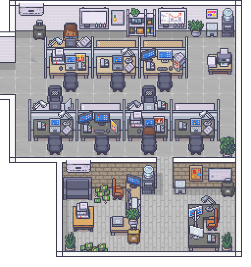

# DENIZEN

**Real-time visual observability layer for AI agents.** Watch autonomous AI agents collaborate, communicate, and execute tasks in a pixel-art office — every agent action rendered as NPC behavior you can see.



> The project itself lives in [`apps/office/`](apps/office/) — that subdirectory is the actual application. The full documentation, including the deep dive on every feature, lives at **[apps/office/README.md](apps/office/README.md)**.

---

## The 30-second version

Denizen renders AI agent workflows as a living pixel-art office. 16 NPCs are real AI agents — each one has a personality (`SOUL.md`), a persistent memory (`MEMORY.md`), and a job. They walk around, talk, sit at desks, run meetings, write reports, file bug reports, and execute real tools — and you watch them do it in real time. Instead of staring at terminal logs or dashboards, you see the *shape* of what your agents are doing.

**Built with:** Node.js 22+, Phaser 3, WebSocket, LM Studio (local), Claude / Grok / Gemini / Kimi (cloud), Kali Linux (security + compute mesh), Tailscale (home fleet).

## Repository layout

This monorepo groups the Denizen app, home-lab infra, and related tooling. See [MONOREPO.md](MONOREPO.md) for a fuller map.

| Path | What it is |
|------|------------|
| [`apps/office/`](apps/office/) | Denizen application — Node/Phaser office, Jelly skills, Supabase migrations, docs, tests |
| [`infra/`](infra/) | Dolonia home lab — NAS/Kali deploy scripts, Tailscale mesh, `finish-all-mesh.py` |
| [`VisionClaw/`](VisionClaw/) | Android client — camera/audio relay for agent vision experiments |
| [`watchdog.ps1`](watchdog.ps1) | Windows service watchdog (OpenClaw gateway, bridge, cloudflared, Denizen) |
| [`OPENCLAW_STAR_OFFICE_QUICKSTART.md`](OPENCLAW_STAR_OFFICE_QUICKSTART.md) | Launcher guide for OpenClaw + Star-Office-UI on Windows |

## Quick Start

From the **repo root** (npm workspaces):

```bash
git clone https://github.com/Dolonia333/DENIZEN.git
cd DENIZEN
npm install
npm start
```

Or from the app directory directly:

```bash
cd DENIZEN/apps/office
npm install
npm start
```

Open **http://localhost:8080**. You should see 16 NPCs moving around, talking, taking breaks.

No API keys needed — Denizen runs in zero-config demo mode out of the box with smart scripted fallback responses. Configure real AI providers (Claude, Grok, LM Studio) for live agent behavior. See [apps/office/README.md → Configuration](apps/office/README.md#configuration) for setup.

## What's actually shipping today

The recent push moved Denizen from "watch agents work" to "agents who actually get work done":

- **Phase 1** — Mood system, directive inbox, OpenClaw skill bridge (NPCs can execute real tools), full SOULs for Marcus + Sarah
- **Phase 2** — Lucy email auto-send + 7-step job pipeline, Bouncer structured Kali investigations with Dan escalation, Work Output Feed UI (Tab key)
- **Phase 3** — NPCs run Claude Code on real files (isolated worktrees + human-approval gate), multi-step task chains (spec→design→code→review→QA), NPC disagreement detection → Abby arbitrates
- **Compute mesh** — Three-node home fleet (dolonia GPU host, Synology NAS, Kali laptop): shared job queue, fleet metrics, Denizen Desktop contributor nodes, mesh jobs UI. See [apps/office/docs/COMPUTE_MESH.md](apps/office/docs/COMPUTE_MESH.md).
- **Phase 5 spec** — Continuous improvement loop where Abby teaches the team to get better over time. Detailed in [apps/office/docs/ROADMAP.md](apps/office/docs/ROADMAP.md).

See [apps/office/docs/ROADMAP.md](apps/office/docs/ROADMAP.md) for the full capability matrix and build order.

## Documentation

| Doc | Contents |
|-----|----------|
| **[MONOREPO.md](MONOREPO.md)** | Repo-wide layout — denizen, infra, VisionClaw, openclaw, root scripts |
| **[apps/office/README.md](apps/office/README.md)** | Full project README with architecture, runtime systems, APIs, and operations |
| **[apps/office/docs/DOCS_INDEX.md](apps/office/docs/DOCS_INDEX.md)** | Master documentation map with categories and GitHub vs local/new status |
| **[apps/office/docs/WORKSPACE_ARCHITECTURE.md](apps/office/docs/WORKSPACE_ARCHITECTURE.md)** | Canonical module map — every folder/file, purpose, dependencies |
| **[apps/office/docs/SERVER.md](apps/office/docs/SERVER.md)** | `server.js` route and module map |
| **[apps/office/docs/VISITOR_UI.md](apps/office/docs/VISITOR_UI.md)** | Visitor browser UI — session modal, projects panel, feature gating |
| **[apps/office/docs/RUNTIME_DATA.md](apps/office/docs/RUNTIME_DATA.md)** | Runtime JSON & reports — writers, readers, PII policy, cleanup |
| [apps/office/docs/SETUP.md](apps/office/docs/SETUP.md) | End-to-end install and environment configuration |
| [apps/office/docs/VISITOR_ONBOARDING.md](apps/office/docs/VISITOR_ONBOARDING.md) | Team vs demo visitor auth, session tokens, CEO path |
| [apps/office/docs/ARCHITECTURE.md](apps/office/docs/ARCHITECTURE.md) | Runtime topology and component relationships |
| [apps/office/docs/AI-SYSTEM.md](apps/office/docs/AI-SYSTEM.md) | NPC intelligence, planning, and memory behaviors |
| [apps/office/docs/WORLD-STATE.md](apps/office/docs/WORLD-STATE.md) | Shared world-state model and outbound events |
| [apps/office/docs/INTELLIGENCE_SPINE.md](apps/office/docs/INTELLIGENCE_SPINE.md) | Facts → outcomes → predictions loop (v1.1/v1.2) |
| [apps/office/docs/DATABASE_SCHEMA.md](apps/office/docs/DATABASE_SCHEMA.md) | Database schema, entities, and relationships |
| [apps/office/docs/MIROFISH_PREDICTION.md](apps/office/docs/MIROFISH_PREDICTION.md) | MiroFish HTTP integration and heuristic fallback |
| [apps/office/docs/OPENCLAW_INTEGRATION.md](apps/office/docs/OPENCLAW_INTEGRATION.md) | OpenClaw bridge and runtime behavior |
| [apps/office/docs/JELLY_INTEGRATION.md](apps/office/docs/JELLY_INTEGRATION.md) | Jelly skill executor and supabase-bridge |
| [apps/office/docs/EMAIL_INTEGRATION.md](apps/office/docs/EMAIL_INTEGRATION.md) | Lucy email ingestion, gating, and automation |
| [apps/office/docs/JOB_CRM.md](apps/office/docs/JOB_CRM.md) | Roki job applications and Supabase sync |
| [apps/office/docs/FEDERAL_PIPELINE.md](apps/office/docs/FEDERAL_PIPELINE.md) | Federal RFP pipeline and org-gated briefing |
| [apps/office/docs/ROBINHOOD_LIVE.md](apps/office/docs/ROBINHOOD_LIVE.md) | Robinhood live integration and operational caveats |
| [apps/office/docs/NPCS.md](apps/office/docs/NPCS.md) | NPC roster, personalities, roles, and capabilities |
| [apps/office/docs/VOICE.md](apps/office/docs/VOICE.md) | TTS architecture and presence gating |
| [apps/office/docs/VOICE_INPUT.md](apps/office/docs/VOICE_INPUT.md) | Push-to-talk speech input and action routing |
| [apps/office/docs/FULL_WORLD.md](apps/office/docs/FULL_WORLD.md) | Multi-zone LimeZu world assembly guide *(local)* |
| [apps/office/docs/LIMEZU_PLACEMENT.md](apps/office/docs/LIMEZU_PLACEMENT.md) | LimeZu placement and layering guide *(local)* |
| [apps/office/docs/SPRITE_FIX_GUIDE.md](apps/office/docs/SPRITE_FIX_GUIDE.md) | Sprite troubleshooting and correction workflow *(local)* |
| [apps/office/docs/SECURITY.md](apps/office/docs/SECURITY.md) | Threat categories, detection, and response flow |
| [apps/office/docs/COMPUTE_MESH.md](apps/office/docs/COMPUTE_MESH.md) | Distributed compute mesh — job queue, fleet agents, NAS/Kali/Desktop deploy |
| [infra/README.md](infra/README.md) | Home lab infrastructure — NAS SSH, Kali pull install, Tailscale, migrations |
| [apps/office/docs/PRODUCTION_DEPLOY.md](apps/office/docs/PRODUCTION_DEPLOY.md) | Production deployment checklist and runbook |
| [apps/office/docs/TESTING.md](apps/office/docs/TESTING.md) | Test pyramid, smoke scripts, pre-deploy checklist |
| [apps/office/desktop/README.md](apps/office/desktop/README.md) | Denizen Desktop — setup wizard, compute contributor node, Windows installer |
| [apps/office/docs/SESSION_2026-06-05.md](apps/office/docs/SESSION_2026-06-05.md) | Session log for Jelly migration and provider rebalance *(local)* |
| [apps/office/docs/ROADMAP.md](apps/office/docs/ROADMAP.md) | Capability roadmap and delivery phases |

## Why NPCs?

Denizen isn't a game. The NPCs aren't decoration — each one is a real AI agent doing a specific job. The point: AI agent workflows are easier to debug, monitor, and trust when you can *see* them. A two-second glance at the office tells you what's blocked, who's escalated, what's chained together. A log dashboard couldn't tell you the same in two minutes.

See [apps/office/README.md → Why NPCs?](apps/office/README.md#why-npcs-the-design-philosophy) for the design philosophy and how to remap the roster to any business (customer support, sales pipeline, research lab, trading desk, hospital ops).

## License

Code: **MIT with Commons Clause v1.0**. You can use, modify, and redistribute freely — you just can't sell hosted/managed versions of Denizen itself. Full terms in [`apps/office/LICENSE`](apps/office/LICENSE).

Art assets: [LimeZu Modern Office](https://limezu.itch.io/) — see their license terms.
