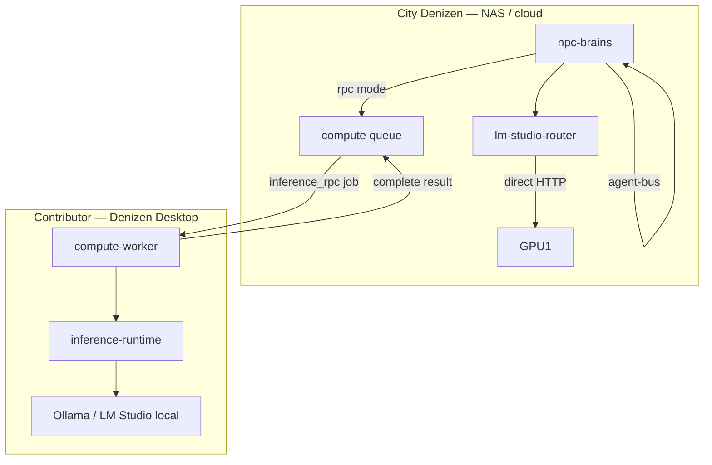

# Denizen Inference Mesh — Plan & Architecture

> **Goal:** Make Denizen feel like the inference engine while contributors only install Denizen Desktop. NPC chat and mesh jobs route through **Denizen-to-Denizen RPC** when direct HTTP to a GPU port is unavailable (NAT, no firewall holes).

## Problem (before)

| Layer | What happened |
|-------|----------------|
| NPC chat | NAS `npc-brains` → HTTP → `192.168.x.x:1234` (LM Studio) |
| Mesh jobs | Worker claims job → local `127.0.0.1:1234` only |
| Contributor UX | Install LM Studio, expose port `0.0.0.0`, edit env vars |
| NAT / remote | Contributor GPU unreachable unless LAN/Tailscale port open |

NPC-to-NPC **messages** already worked via `agent-bus` (no LLM). Only **thinking** needed the bridge.

## Target architecture



### Two inference paths (both supported)

| Mode | When | How |
|------|------|-----|
| **direct** | Host can reach contributor's advertised URL (LAN/Tailscale) | OpenAI-compatible `POST /v1/chat/completions` |
| **mesh_rpc** | Contributor has local brain but no network exposure | `inference_rpc` job → worker runs locally → returns text |

## Implementation phases

### Phase 1 — Unified inference runtime ✅ (this PR)

| File | Purpose |
|------|---------|
| `src/denizen-inference-runtime.js` | Probe + chat for **Ollama** and **LM Studio** |
| `src/denizen-inference-rpc.js` | Enqueue/wait `inference_rpc` jobs on city server |
| `src/denizen-mesh-job-runner.js` | Runs `inference_rpc` + `npc_think_batch` via runtime |
| `src/denizen-hardware-monitor.js` | Reports `inference` block in heartbeats |
| `src/lm-studio-router.js` | `rpc_capable`, `inference_mode`, scoring for RPC nodes |
| `src/npc-brains.js` | Auto-fallback to mesh RPC when direct fails |
| `POST /api/compute/inference/run` | Debug / API inference with auto routing |

**Env vars**

```env
DENIZEN_INFERENCE_BACKEND=auto   # auto | ollama | lmstudio
OLLAMA_URL=http://127.0.0.1:11434
LM_STUDIO_URL=http://127.0.0.1:1234
DENIZEN_INFERENCE_RPC_TIMEOUT_MS=120000
```

### Phase 2 — Desktop “Download brain” UX ✅ (wizard)

- Setup wizard **City Power** step probes Ollama/LM Studio
- **Download starter brain** → `ollama pull llama3.2` (when Ollama installed)
- IPC: `getInferenceStatus`, `pullBrainModel`

### Phase 3 — Contributor path (no NAS env editing)

1. Install Denizen Desktop
2. Enable **City Power** in wizard
3. Install Ollama (or keep LM Studio)
4. Pair Citizen ID
5. Desktop heartbeats report `inference.rpc_capable: true`
6. City routes chat via **direct** or **mesh_rpc** automatically

See also [LM_STUDIO_CONTRIBUTE.md](LM_STUDIO_CONTRIBUTE.md) for LM Studio-specific steps.

### Phase 4 — Product & scale (planned)

Full breakdown: **[GAP_CLOSURE_PLAN.md](GAP_CLOSURE_PLAN.md)** (master checklist, sprints, acceptance criteria).

| Item | Sprint | Notes |
|------|--------|-------|
| Bundle Ollama in Desktop installer | 2 | `extraResources` + spawn `ollama serve` |
| Model catalog UI | 2 | Curated catalog + pull progress |
| Streaming mesh RPC | 3 | Token stream over `inference_rpc` + progress API |
| Embed llama.cpp | Backlog | Only if Ollama bundling blocked |
| `embedding_index` / `sim_tick` real execution | 3 | Embeddings + lightweight sim tick |
| Cross-city federation | Backlog | Signed peer fleet reports |
| Deploy to NAS + smoke RPC | 1 | `hotfix-sync-denizen-nas.py` |
| Public demo Haiku | 1 | `DENIZEN_PUBLIC_DEMO_ANTHROPIC_KEY` |
| Standby failover | 4 | Cloudflare repoint script |
| 100 game viewers / horizontal WS | Backlog | Redis pub/sub — see MESH_SCALING Phase 5 |

## APIs

### `GET /api/compute/inference/nodes`

Router status — each node now includes:

```json
{
  "node_id": "desktop-abc",
  "reachable": false,
  "reachable_local": true,
  "rpc_capable": true,
  "inference_mode": "rpc",
  "inference_backend": "ollama"
}
```

### `POST /api/compute/inference/run`

```json
{
  "session_id": "...",
  "system_prompt": "You are Rob.",
  "messages": [{ "role": "user", "content": "Hello" }],
  "tier": "main",
  "mode": "auto"
}
```

Response:

```json
{
  "ok": true,
  "text": "...",
  "mode": "mesh_rpc",
  "backend": "ollama",
  "node_id": "desktop-abc"
}
```

### Mesh job: `inference_rpc`

Payload (targeted at one machine):

```json
{
  "target_machine_id": "desktop-abc",
  "system_prompt": "...",
  "messages": [...],
  "model": "llama3.2",
  "tier": "main",
  "max_tokens": 256
}
```

Only the matching worker (same `machine_id` on claim) executes the job.

## Heartbeat shape (workers)

```json
{
  "machine_id": "desktop-abc",
  "contributing": true,
  "inference": {
    "backend": "ollama",
    "url": "http://127.0.0.1:11434",
    "reachable_local": true,
    "rpc_capable": true,
    "models": ["llama3.2"],
    "main_model": "llama3.2"
  },
  "lm_studio": { }
}
```

`lm_studio` remains for backward compatibility; router prefers `inference` when present.

## What did NOT change

- **Agent bus** — still in-process NPC DMs on one city server
- **MCP** — external AI ↔ one NPC sync layer (separate from mesh inference)
- **Cloud providers** — Anthropic/Google/OpenAI paths unchanged
- **Game state** — still one primary Denizen process per office

## Smoke checks

```powershell
cd denizen
node --test tests/denizen-inference-runtime.test.js
node --test tests/denizen-inference-rpc.test.js
node --test tests/lm-studio-router.test.js

# With server running + Supabase queue:
curl -X POST http://127.0.0.1:8081/api/compute/inference/run `
  -H "Content-Type: application/json" `
  -d '{"session_id":"...","messages":[{"role":"user","content":"ping"}]}'
```

## Gap closure checklist

| Gap | Status |
|-----|--------|
| No Ollama support | ✅ `denizen-inference-runtime` |
| No inference proxy API | ✅ `POST /api/compute/inference/run` |
| No Denizen-to-Denizen LLM | ✅ `inference_rpc` job type |
| Mesh jobs ignore router | ✅ Workers use unified runtime; interactive uses router + RPC fallback |
| Must expose port 1234 | ✅ RPC path works without network exposure |
| Two-app contributor UX | 🟡 Wizard + Ollama pull; bundled Ollama in [GAP_CLOSURE_PLAN](GAP_CLOSURE_PLAN.md) Sprint 2 |
| Mock job types | 🔲 Sprint 3 — `embedding_index`, `sim_tick` |
| Not deployed to NAS | 🔲 Sprint 1 — hotfix sync |
| Streaming RPC | 🔲 Sprint 3 |
