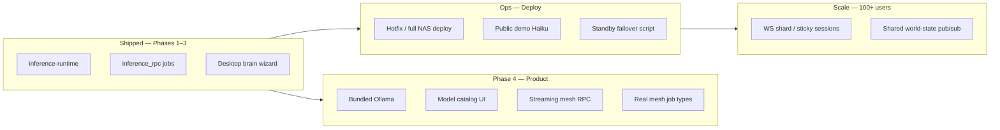

# Gap Closure Plan — Phase 4+ (Master)

> Single execution plan to finish **Denizen-as-engine**, **production hardening**, **mesh scale**, and **product roadmap** items.  
> Inference mesh Phases 1–3 are shipped in code; this doc covers everything left.

**Related docs**

| Doc | Scope |
|-----|--------|
| [DENIZEN_INFERENCE_MESH.md](DENIZEN_INFERENCE_MESH.md) | Inference architecture (direct + `inference_rpc`) |
| [MESH_SCALING.md](MESH_SCALING.md) | NAS hosting, standby, 100-user capacity |
| [COMPUTE_MESH.md](COMPUTE_MESH.md) | Job queue, fleet agents, router |
| [ROADMAP.md](ROADMAP.md) | NPC capability phases 4–5 |
| [MULTI_USER_OFFICE_PLAN.md](MULTI_USER_OFFICE_PLAN.md) | Multi-company offices — DB souls, org isolation, templates |
| [NAS_PLATFORM_BRIDGE.md](NAS_PLATFORM_BRIDGE.md) | Cloud CRM bridge vs NAS-only |

---

## Executive summary



| Horizon | Goal | Outcome |
|---------|------|---------|
| **Week 1** | Deploy + verify inference mesh on NAS | Public city uses direct + RPC paths live |
| **Weeks 2–4** | Phase 4 inference product | One installer, download brain, no LM Studio required |
| **Weeks 4–8** | Real mesh workloads + streaming | Background jobs actually run; chat streams over RPC |
| **Ongoing** | Scale + roadmap | Standby, 100 CRM users, Abby competency loop |

---

## Workstream A — Inference mesh Phase 4 (Denizen-as-engine)

### A1. Bundle Ollama in Desktop installer

**Problem:** Contributors still install Ollama separately; wizard `pull-brain` fails if Ollama missing.

**Deliverables**

| # | Task | Files / notes |
|---|------|----------------|
| A1.1 | Download Ollama binary at build time (win/mac/linux) | `desktop/scripts/fetch-ollama.js`, `electron-builder` `extraResources` |
| A1.2 | Spawn bundled `ollama serve` from `main.js` on City Power opt-in | Port `11434`, child process lifecycle on quit |
| A1.3 | Health: `getInferenceStatus` prefers bundled instance | Env `DENIZEN_BUNDLED_OLLAMA=1` |
| A1.4 | NSIS/DMG copy: optional component “Include AI brain runtime” | Smaller install without GPU users |

**Acceptance**

- Fresh Windows install → wizard → “Download starter brain” succeeds with **no** prior Ollama install.
- Uninstall / quit Denizen stops bundled `ollama serve`.

**Effort:** ~3–5 days · **Depends on:** electron-builder CI, code signing (Windows SmartScreen)

---

### A2. Model catalog UI (Hugging Face–style)

**Problem:** Users don’t know which model to pull; `llama3.2` is a hardcoded default.

**Deliverables**

| # | Task | Notes |
|---|------|-------|
| A2.1 | Curated catalog JSON | `desktop/data/brain-catalog.json` — id, label, vram_gb, tier (`fast`/`main`), ollama tag |
| A2.2 | Wizard + City Power panel UI | Cards with VRAM estimate, “Download”, progress bar |
| A2.3 | `pullBrainModel` streams progress | Parse `ollama pull` stdout → IPC events → UI |
| A2.4 | Persist choice in setup state | `brain_model`, `brain_backend` → heartbeat `inference.main_model` |
| A2.5 | Server-side catalog endpoint (optional) | `GET /api/compute/inference/catalog` for web City Power mirror |

**Starter catalog (example)**

| Model | Tier | Min VRAM | Use |
|-------|------|----------|-----|
| `llama3.2:3b` | fast | 4 GB | Light stations |
| `llama3.2` | main | 8 GB | Default |
| `qwen2.5:7b` | main | 8 GB | Office / code |
| `ministral-3-8b` | main | 10 GB | Match dolonia fleet |

**Acceptance**

- User picks model from UI; pull shows % progress; City Power panel shows model name after complete.

**Effort:** ~2–3 days · **Depends on:** A1 (or existing Ollama)

---

### A3. Streaming mesh RPC

**Problem:** `inference_rpc` is batch-only; NPC chat streaming (`onToken`) still needs direct HTTP.

**Deliverables**

| # | Task | Notes |
|---|------|-------|
| A3.1 | Job payload `stream: true` | `inference_rpc` partial results in `denizen_compute_jobs.result` or new `progress` column |
| A3.2 | Worker streams tokens to server | `POST /api/compute/node/progress` with `jobId`, `delta` |
| A3.3 | Server holds subscribers | In-memory `jobId → Set<ws|res>` or SSE on `/api/compute/inference/stream?job=…` |
| A3.4 | `npc-brains._callLocalRouted` RPC stream path | `waitForJob` replaced by progress subscription when `opts.stream.onToken` |
| A3.5 | Timeout + cancel | `DELETE /api/compute/jobs/:id` aborts worker fetch |

**Acceptance**

- Contributor behind NAT: player chat to NPC shows token-by-token reply via mesh RPC.
- Latency within 2× direct path for same model (acceptable for v1).

**Effort:** ~4–6 days · **Depends on:** stable `inference_rpc` in production (Workstream B)

---

### A4. Embed llama.cpp (optional — de-risk Ollama dependency)

**Problem:** Ollama is a separate product; licensing/size; offline air-gap.

**Options**

| Option | Pros | Cons |
|--------|------|------|
| **A4a. node-llama-cpp** | Pure Node, no binary | Build complexity, CUDA bindings |
| **A4b. Ship llama-server binary** | Fast, proven | Per-platform builds, larger artifact |
| **A4c. Stay on Ollama** | Done in A1 | External dependency |

**Recommendation:** Ship **A1 (bundled Ollama)** first; spike **A4b** only if Ollama bundling blocks signing or size budget (>500 MB).

**Effort:** Spike 2 days; full embed 2–3 weeks

---

### A5. Real mesh job types (`embedding_index`, `sim_tick`)

**Problem:** `denizen-mesh-job-runner.js` mocks these; queue fills with no real work.

**Deliverables**

| Job type | Real behavior | Primary file |
|----------|---------------|--------------|
| `embedding_index` | Chunk docs → embed via Ollama `/api/embeddings` or LM Studio embed endpoint → upsert `npc_memory_embeddings` (new table or pgvector) | `denizen-embedding-worker.js` |
| `sim_tick` | Lightweight world tick: decay moods, advance meeting timers, enqueue think hints — **no LLM** unless producer asks | `denizen-sim-tick.js` |
| `npc_think_batch` | Already real via inference-runtime | done |

**Acceptance**

- `node scripts/smoke-mesh-jobs-flow.js` shows non-mocked `embedding_index` result.
- Producer no longer trimmed as “mock backlog”.

**Effort:** ~3–4 days embeddings · ~1 day sim_tick

---

### A6. Cross-city federation (two public Denizen instances)

**Problem:** Single primary server; no RPC between `denizen.dolonia.cloud` and another city.

**Deliverables (v1 minimal)**

| # | Task |
|---|------|
| A6.1 | `DENIZEN_FEDERATION_PEERS=https://other.city` env |
| A6.2 | Signed fleet report ingest from remote city (`X-Federation-Token`) |
| A6.3 | Router treats peer GPUs like fleet nodes (direct only; RPC stays intra-city) |
| A6.4 | Docs: trust model, no shared Supabase required for inference-only peering |

**Defer:** Shared CRM, cross-city agent-bus, unified Citizen ID.

**Effort:** ~1 week · **Priority:** low until second city exists

---

## Workstream B — Production deploy & ops (bridge now → live)

Code for inference mesh is **not on NAS** until deployed.

### B1. Deploy inference mesh to NAS

| Step | Command / action |
|------|------------------|
| 1 | `py infra/hotfix-sync-denizen-nas.py` (changed: runtime, rpc, router, npc-brains, mesh runner, hardware monitor, compute routes, queue) |
| 2 | `py infra/patch-denizen-nas-env.py` — add `DENIZEN_INFERENCE_RPC_TIMEOUT_MS=120000` |
| 3 | Restart container |
| 4 | Smoke: `GET /api/compute/inference/nodes` shows `rpc_capable`, `inference_mode` |
| 5 | Smoke: `POST /api/compute/inference/run` with team session |

**Acceptance:** NAS routes to dolonia direct **and** Desktop RPC when direct fails.

**Effort:** ~2 hours

---

### B2. Public demo mode (Haiku path)

| # | Task | Env / file |
|---|------|------------|
| B2.1 | Set `DENIZEN_PUBLIC_DEMO_ANTHROPIC_KEY` on NAS | `.env.production` |
| B2.2 | Verify `?mode=demo` uses Haiku not LM Studio | `public-demo-mode.js` |
| B2.3 | Optional: enable visitor chat in demo (read-only → interactive) | product decision |

**Effort:** ~1 hour ops · ~1 day if interactive demo

---

### B3. Standby failover automation

| # | Task | File |
|---|------|------|
| B3.1 | `infra/health-failover-nas.py` — probe primary, repoint Cloudflare tunnel | exists — verify + document |
| B3.2 | dolonia standby `.env`: `DENIZEN_SERVER_ROLE=standby`, `PORT=8081` | MESH_SCALING.md |
| B3.3 | Runbook: WS reconnect message in UI on failover | `visitor-node-ui.js` |

**Effort:** ~4 hours test + runbook

---

### B4. Security hygiene

| Item | Action |
|------|--------|
| Rob MCP token | Rotate token posted in chat; update NAS env |
| `DENIZEN_INTERNAL_API_TOKEN` | Rotate if ever exposed |
| Fleet agent tokens | Per-machine scoped tokens (future) |

**Effort:** ~30 minutes

---

### B5. Platform bridge (cloud CRM)

| Mode | Action |
|------|--------|
| **NAS-only (current)** | Keep `DENIZEN_PLATFORM_BRIDGE=false`; CRM local tables only |
| **Cloud sync desired** | Apply migrations `000005`–`000014` on **cloud** Supabase; enable bridge on cloud Denizen host only |

No NAS work unless you colocate cloud schema on NAS (not recommended).

**Effort:** 0 on NAS · ~1 day cloud migration if needed

---

### B6. Full image deploy path

When Docker Desktop available:

```powershell
py infra/deploy-denizen-to-nas.py
```

Ensures Dockerfile.production + `docker-compose.production.yml` match hotfix files.

**Effort:** ~1 hour

---

## Workstream C — Contributor UX polish

### C1. Update LM_STUDIO_CONTRIBUTE.md

Add **Ollama + mesh RPC** path (no port 1234 required):

- City Power → RPC mode when `inference_mode: rpc`
- Ollama install OR bundled Ollama (post A1)
- Troubleshooting: “reachable false but rpc_capable true” is OK

**Effort:** ~1 hour

---

### C2. City Power panel (browser)

| # | Task |
|---|------|
| C2.1 | Show `inference_mode` + `inference_backend` per node |
| C2.2 | “Download brain” deep link → opens Desktop wizard |
| C2.3 | Copy: “No firewall setup needed” when RPC active |

**File:** `src/visitor-node-ui.js`

**Effort:** ~1 day

---

### C3. Desktop agent settings

Post-wizard: change brain model, pause City Power, view RPC vs direct stats.

**File:** `desktop/agent-settings.html` + IPC

**Effort:** ~1 day

---

## Workstream D — Scale (MESH_SCALING Phase 4–5)

### D1. ~100 CRM / visitor users (achievable now)

| Knob | Recommended NAS value |
|------|------------------------|
| `DENIZEN_MAX_WS_CLIENTS` | `30` demo / `50` team |
| `DENIZEN_MESH_MAX_PENDING` | `20` |
| `LM_STUDIO_SATURATED_QUEUE` | `6` |
| Mesh GPUs | dolonia + 2 Desktop nodes |

**Monitor:** `GET /api/compute/node/status`, mesh panel `?mesh=1`

---

### D2. 100 concurrent game viewers (Phase 5 — not home-lab default)

Requires:

| # | Component |
|---|-----------|
| D2.1 | Sticky sessions (Cloudflare affinity) |
| D2.2 | Redis or Supabase Realtime pub/sub for world-state |
| D2.3 | Single simulation leader; viewers read replicas |
| D2.4 | Optional spectator mode (CDN static + WS for chat only) |

**Effort:** 3–6 weeks · **Trigger:** when WS cap hit in production metrics

---

## Workstream E — Product roadmap (ROADMAP Phase 4–5)

### E1. Phase 4 production (from ROADMAP.md)

| Item | Status | Next step |
|------|--------|-----------|
| 4.1 Public demo | 🟡 Scaffolded | B2 — Haiku key |
| 4.2 Performance | 🟡 Ongoing | Memory compression, prompt token budget |
| 4.3 Docker deploy | 🟡 Scaffolded | B6 — production checklist |

---

### E2. Phase 5 continuous improvement

| Sub-phase | Deliverable | Status |
|-----------|-------------|--------|
| 5.1 Outcome scorer + competency map | `outcome-scorer.js`, `GET /api/competency-map` | ✅ Scaffolded |
| 5.2 Abby gap-aware + training tasks | Wire competency into `cofounder-agent.js` | 🔲 |
| 5.3 Auto capability proposals | `capability-proposals` UI | 🔲 |

**Effort:** ~1.5 days per sub-phase (per ROADMAP)

---

## Workstream F — Testing & observability

### F1. Automated tests to add

| Test | Covers |
|------|--------|
| `denizen-inference-rpc.integration.test.js` | enqueue → mock worker complete → `waitForJob` |
| `mesh-job-runner.inference_rpc.test.js` | payload → text result |
| `smoke-inference-rpc-nas.js` | Live NAS + Desktop RPC round-trip |
| Router regression | RPC node preferred when direct down |

---

### F2. Metrics (lightweight)

| Metric | Where |
|--------|-------|
| `inference_requests_total{mode=direct\|rpc}` | log line or `/api/health` |
| `inference_rpc_latency_ms` | contribution tracker |
| `mesh_job_type_duration` | per job complete |

---

## Prioritized execution order

### Sprint 1 — Go live (1–2 days)

1. **B1** Deploy inference mesh to NAS  
2. **B4** Rotate MCP token  
3. **B2** Public demo Haiku key (optional)  
4. **F1** `smoke-inference-rpc-nas.js`  
5. **C1** Doc update  

**Exit criteria:** Production city uses inference mesh; RPC path verified with one Desktop contributor.

---

### Sprint 2 — Contributor product (1–2 weeks)

1. **A1** Bundled Ollama  
2. **A2** Model catalog + progress UI  
3. **C2** City Power panel inference mode  
4. **C3** Agent settings brain management  

**Exit criteria:** New user: install Desktop only → download brain → City Power on → NPC chat works without LM Studio.

---

### Sprint 3 — Mesh depth (2 weeks)

1. **A3** Streaming mesh RPC  
2. **A5** Real `embedding_index` + `sim_tick`  
3. **F2** Basic inference metrics  

**Exit criteria:** Streaming chat over RPC; no mocked job types in smoke suite.

---

### Sprint 4 — Resilience & scale (ongoing)

1. **B3** Standby failover tested  
2. **B6** Full Docker deploy pipeline  
3. **D1** Load tuning for 100 CRM users  
4. **E2** Abby gap-aware (5.2)  

---

### Backlog (when needed)

- **A4** llama.cpp embed  
- **A6** Cross-city federation  
- **D2** Horizontal game scale  
- **B5** Cloud platform bridge  

---

## Gap checklist (master)

| Gap | Workstream | Sprint |
|-----|------------|--------|
| Inference mesh not deployed to NAS | B1 | 1 |
| Two-app contributor UX (LM Studio) | A1, A2 | 2 |
| No streaming over RPC | A3 | 3 |
| Mock `embedding_index` / `sim_tick` | A5 | 3 |
| No bundled runtime | A1 / A4 | 2 / backlog |
| Public demo uses LM not Haiku | B2 | 1 |
| No standby automation | B3 | 4 |
| Platform bridge on NAS | B5 | backlog (cloud only) |
| 100 game viewers | D2 | backlog |
| Abby competency loop | E2 | 4 |
| Cross-city inference | A6 | backlog |
| MCP token rotation | B4 | 1 |
| City Power UI doesn’t show RPC mode | C2 | 2 |

---

## Decision log (record choices here)

| Date | Decision | Rationale |
|------|----------|-----------|
| 2026-06-22 | Prefer bundled **Ollama** over llama.cpp for Phase 4 | Faster to ship; OpenAI-compatible API already wired |
| 2026-06-22 | **RPC stays intra-city** for v1 | Simpler auth; federation v2 for cross-city |
| TBD | Interactive public demo | Product: watch-only vs chat demo |

---

## Owner commands quick reference

```powershell
# Deploy inference mesh
py infra/hotfix-sync-denizen-nas.py
py infra/probe-denizen-nas.py

# Full deploy
py infra/deploy-denizen-to-nas.py

# Tests
cd denizen
node --test tests/denizen-inference-*.test.js tests/lm-studio-router.test.js

# Desktop build (after A1)
cd denizen/desktop
npm run build:win
```

---

*Last updated: 2026-06-22 — aligns with DENIZEN_INFERENCE_MESH Phases 1–3 shipped in repo.*
