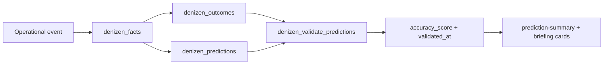
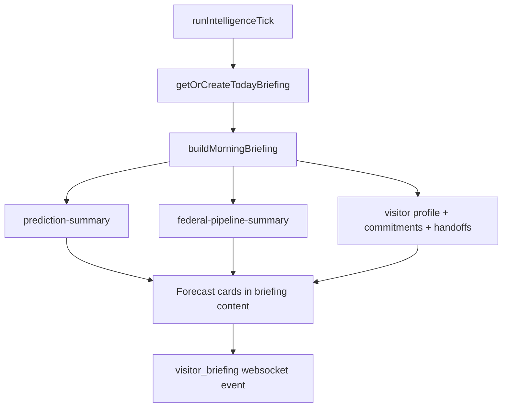

# Denizen Intelligence Spine (v1.1 / v1.2)

The intelligence spine is Denizen's durable learning loop: operational events become immutable facts, facts are converted into outcomes, and outcomes continuously validate predictions.

Related docs:
- [Database schema](DATABASE_SCHEMA.md)
- [Architecture](ARCHITECTURE.md)
- [Visitor onboarding](VISITOR_ONBOARDING.md)

---

## Version tags

| Tag | Meaning | Coverage |
|---|---|---|
| `v1.1-schema-complete` | Core intelligence schema and trigger wiring landed | Facts, outcomes, predictions, org bridge, outcome validation |
| `v1.2-intelligence-complete` | Visitor intelligence + platform identity + trading spine landed | Briefings, proactive events, team auth bridge, watchlist/trade suggestions |

---

## Core loop: fact -> outcome -> prediction

### Data contract

| Layer | Storage | Write path | Why it exists |
|---|---|---|---|
| Facts | `denizen_facts` | `denizen_record_fact(...)` RPC and trigger-based inserts | Immutable event history for analytics and model features |
| Outcomes | `denizen_outcomes` | `denizen_record_outcome(...)` RPC and trigger labels | Ground truth labels for conversion/bid/rejection outcomes |
| Predictions | `denizen_predictions` | Trigger heuristics, app-layer writes, MiroFish sync | Forward-looking forecasts that are later scored |

`denizen_record_outcome(...)` calls `denizen_validate_predictions(...)` to auto-backfill:
- `validated_at`
- `actual_outcome_id`
- `accuracy_score`

---

## Fact writers by surface

| Surface | Primary tables/functions | Example fact types |
|---|---|---|
| Website intake | `intake_forms` trigger (`denizen_trg_intake_forms`) | `intake.submitted`, `intake.status_changed`, `intake.followed_up` |
| Leads | `leads` trigger (`denizen_trg_leads`) | `lead.submitted`, `lead.status_changed` |
| RFP pipeline | `rfps` trigger (`denizen_trg_rfps`) | `rfp.ingested`, `rfp.bid_decision_set`, `rfp.status_changed` |
| Client lifecycle | `clients` trigger (`denizen_trg_clients`) | `client.created` |
| Appointments | `client_appointments` trigger (`denizen_trg_client_appointments`) | `appointment.booked`, `appointment.status_changed` |
| Job applications | `denizen_job_applications` trigger + app service | `job_application.created`, `job_application.status_changed`, `job.*` outcomes |
| Trade suggestions | `denizen_trade_suggestions` trigger (`denizen_trg_trade_suggestions`) | `trade_suggestion.created` |
| NPC/runtime telemetry | `src/denizen-db.js` (`recordWorkOutput`, `recordLlmEvent`, world state hook) | `npc.work.*`, `llm.completed`, `llm.failed`, `office.*`, `visitor.*` |

---

## Migration timeline (000006-000014)

| Migration | Scope | Key additions |
|---|---|---|
| `000006_outcome_triggers` | Outcome + validation engine | `denizen_record_outcome`, `denizen_validate_predictions`, intake/leads/rfps/clients triggers |
| `000007_entity_key_nullable` | Non-UUID entities | Allows `entity_key` paths (ex: job app text IDs) by dropping `entity_id` NOT NULL constraints |
| `000008_denizen_demo_org` | Demo tenancy | Creates `acme` demo org |
| `000009_visitor_intelligence` | Visitor memory/autopilot | Profiles, commitments, briefings, recurring tasks, proactive events |
| `000010_demo_org_settings` | Tier policy | Demo/team behavior flags in org settings JSON |
| `000011_team_accounts_and_session_auth` | Session hardening | `session_token_hash` + `denizen_team_accounts` |
| `000012_platform_identity_bridge` | Identity + org bridge | `denizen_auth_user_org_ids`, `denizen_user_can_access_org`, job app org/npc/session bridge, appointment/job triggers |
| `000013_platform_tables_admin` | Supabase-admin-owned tables | `client_appointments`/`subscriptions` org bridge, org-scoped RLS policies, appointment trigger attach |
| `000014_roki_trading_spine` | Trading intelligence | `denizen_watchlist_symbols`, `denizen_trade_suggestions`, RLS, trade suggestion fact trigger |

---

## NPC attribution model

Denizen records explicit NPC ownership so analytics and downstream automations can answer "who did this?" without replaying conversation logs.

| Actor | Attribution paths |
|---|---|
| `lucy` | Default agent identity for platform bridge tables (`documents`, `key_value`, `logs`) and many operator workflows |
| `roki` | Default owner for job and trading domains (`denizen_job_applications`, watchlist/trade suggestions) |

Attribution fields used across the spine:
- `actor_type`, `actor_id` in `denizen_facts`
- `npc_key` on org-scoped domain rows
- `source_table`, `source_id` back-links for lineage

---

## Org scope and RLS helpers

The spine is org-first. Every intelligence table that needs tenant isolation uses `org_id`, and reads are enforced through helper functions introduced in `000012`.

| Helper | Purpose |
|---|---|
| `denizen_auth_user_org_ids()` | Resolves org IDs the signed-in user can access from team accounts, owned clients, and admin roles |
| `denizen_user_can_access_org(p_org_id)` | Boolean predicate used directly in RLS policies |

RLS usage examples:
- `intake_forms`, `leads`, `client_appointments`, `subscriptions` (platform table bridge)
- `denizen_watchlist_symbols`, `denizen_trade_suggestions` (trading spine)

---

## API surfaces

### Prediction + pipeline

| Endpoint | Method | Backing module | Response purpose |
|---|---|---|---|
| `/api/intelligence/prediction-summary` | `GET` | `denizen-prediction-loop.getPredictionSummary` | Aggregate prediction counts, validation status, accuracy, typed breakdown |
| `/api/federal/pipeline-summary` | `GET` | `federal-pipeline.getRfpPipelineSummary` | RFP counts by status, pipeline value, upcoming due dates |

### MiroFish integration

| Endpoint | Method | Backing module | Purpose |
|---|---|---|---|
| `/api/intelligence/mirofish-status` | `GET` | `mirofish-prediction` | Check external forecast availability and config |
| `/api/intelligence/mirofish-sync` | `POST` | `runMiroFishMaintenance` | Pull/sync forecasts into `denizen_predictions` |

---

## Morning briefing and forecast cards

`src/denizen-visitor-intelligence.js` composes daily briefings from:
- assistant + project state
- pending handoffs
- open commitments
- federal pipeline summary (team/org-allowed sessions)
- prediction summary + top forecasts
- persisted visitor preferences

Forecast cards are sourced from top-confidence prediction rows and serialized into briefing `content.predictionSummary.topForecasts`.

---

## Operational checklist

- Apply migrations in order, with ownership split (`000012` postgres context, `000013` supabase-admin context).
- Keep writes additive and org-scoped (`org_id`, `npc_key`, `entity_key` where UUID is unavailable).
- Use `denizen_record_fact`/`denizen_record_outcome` helpers instead of ad hoc inserts when possible.
- Verify endpoint health after deploy:
  - `GET /api/intelligence/prediction-summary`
  - `GET /api/federal/pipeline-summary`
  - `GET /api/intelligence/mirofish-status`
  - `POST /api/intelligence/mirofish-sync`
