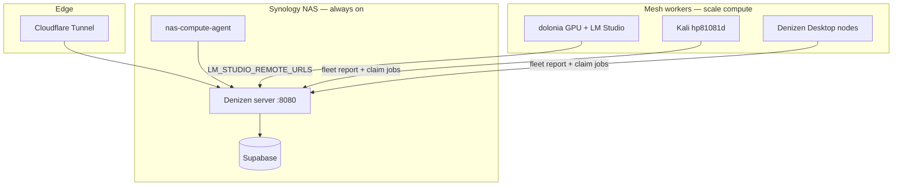
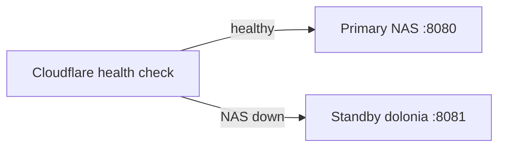

# Mesh scaling, redundancy, and 100-user capacity

How to host Denizen on the NAS, use the home mesh for failover and compute offload, and grow toward ~100 users without breaking the live office.

## Architecture at a glance



| Layer | What scales | How |
|-------|-------------|-----|
| **Website + API** | HTTP, CRM, visitor auth | Single NAS Denizen container (Phase 1) |
| **Database** | Sessions, CRM, compute queue | Supabase on same NAS (already deployed) |
| **AI inference** | NPC brains, chat, skills | Mesh LM Studio pool + cloud APIs |
| **Batch compute** | `npc_think_batch`, `sim_tick` | Mesh job queue — any fleet node claims work |
| **Live game** | WebSocket `/agent-ws`, world-state | **One primary server** today (in-memory state) |

## Phase 1 — Host the website on NAS (do this first)

From repo root on your PC (Docker Desktop required for image build):

```powershell
# 1. Ensure denizen/.env.production has Supabase keys + fleet tokens
py infra/apply-migrations-nas.py
py infra/finish-denizen-on-nas.py
```

This runs: migrations → `provision-nas-server.py` → `deploy-denizen-to-nas.py` → `repoint-mesh-to-nas.py` → smokes.

**Manual cutover (one time):**

1. **Cloudflare Zero Trust** → Tunnels → your NAS tunnel → add/update hostname:
   - `denizen.dolonia.cloud` → `http://192.168.1.237:8080`
2. **Stop dolonia Denizen** so you don't run two primaries (disable watchdog `:8081` restart or stop that process).
3. Verify:
   ```powershell
   py infra/probe-denizen-nas.py
   curl https://denizen.dolonia.cloud/api/health
   ```

**dolonia after cutover:** stays in the mesh as GPU worker — set `LM_STUDIO_URL` on dolonia and add its Tailscale/LAN URL to NAS `.env`:

```env
LM_STUDIO_REMOTE_URLS=http://100.71.54.109:1234
LM_STUDIO_ROUTER=true
```

Paths on NAS:

| Path | Purpose |
|------|---------|
| `/volume1/docker/denizen-server/` | Denizen app container + `.env` |
| `/volume1/docker/supabase-project/` | Supabase stack |
| `/volume1/docker/denizen-agent/` | Headless mesh agent (metrics + job worker) |

## Phase 2 — Mesh redundancy (active / standby)

The mesh **already** gives you distributed compute. For **app uptime**, add a warm standby on dolonia:



| Component | Primary (NAS) | Standby (dolonia) |
|-----------|---------------|-------------------|
| `DENIZEN_SERVER_ROLE` | `primary` | `standby` |
| `DENIZEN_SERVER_ID` | `nas-192.168.1.237` | `dolonia-100.71.54.109` |
| Supabase | `http://127.0.0.1:8000` | `https://supabase.dolonia.cloud` |
| LM Studio | via `LM_STUDIO_REMOTE_URLS` | local `:1234` |

**Standby `.env` on dolonia:**

```env
DENIZEN_SERVER_ROLE=standby
PORT=8081
SUPABASE_URL=https://supabase.dolonia.cloud
DENIZEN_URL=https://denizen.dolonia.cloud
```

**Cloudflare:** configure a health check on `https://denizen.dolonia.cloud/api/health` and a secondary origin pointing at dolonia Tailscale IP `:8081` (or LAN). When NAS fails, flip the tunnel origin manually or via Cloudflare Load Balancing.

**What mesh agents do during failover:** Kali and Desktop agents use `DENIZEN_PUBLIC_URL` — they keep talking to whatever origin Cloudflare routes to. Re-run `py infra/repoint-mesh-to-nas.py` after any URL change.

**Limitation:** world-state and WebSocket sessions are **not** replicated between primaries. Failover means a brief reconnect for users in the live office — acceptable for CRM/visitor traffic, noticeable for in-game viewers.

## Phase 3 — Use mesh to scale AI (not HTTP)

For 100 users, the bottleneck is usually **LLM inference**, not static pages.

| Workload | Where it runs | Scales with |
|----------|---------------|-------------|
| CRM, login, REST APIs | NAS Denizen | Vertical NAS RAM/CPU |
| NPC chat / think | LM Studio router | Add mesh GPUs (dolonia, Desktop, any PC with LM Studio) |
| Background NPC batches | `denizen_compute_jobs` queue | Add `nas-compute-agent` / Desktop workers |
| Cloud fallback | Claude / Grok / Gemini | API rate limits |

**Add a GPU node:**

1. Install LM Studio; listen on `0.0.0.0:1234`.
2. Either add to NAS `.env`:
   ```env
   LM_STUDIO_REMOTE_URLS=http://100.71.54.109:1234,http://100.110.205.49:1234
   ```
3. Or run fleet agent on that machine:
   ```bash
   export DENIZEN_PULL_URL='https://denizen.dolonia.cloud'
   bash infra/pull-install-kali-agent.sh
   ```

**Tune producer for load** (NAS `.env`):

```env
DENIZEN_MESH_JOBS=true
DENIZEN_MESH_JOBS_INTERVAL_MS=180000
DENIZEN_MESH_MAX_PENDING=20
LM_STUDIO_SATURATED_QUEUE=6
```

Monitor: mesh panel (`?mesh=1`) or `GET /api/compute/node/status`.

## Phase 4 — Capacity planning for ~100 users

“100 users” means different things:

| Profile | Concurrent load | Single NAS Denizen | Mesh helps? |
|---------|-----------------|-------------------|-------------|
| **CRM / portal only** | 20–50 active, 100 registered | Yes — typical Synology + 8 GB+ RAM | DB on NAS; AI via mesh |
| **Visitor demos** | 10–20 watching office | Yes with cloud LLMs | Inference pool critical |
| **100 simultaneous game viewers** | 100 WebSockets + Phaser | **No** — needs Phase 5 | Compute only, not WS |

**Rough single-node limits (NAS Denizen + Supabase co-hosted):**

- HTTP/API: hundreds of light requests/min
- WebSocket viewers: ~30–50 comfortable on one Node process
- Mesh job throughput: limited by slowest GPU worker and Supabase queue write rate

**Recommended stack for 100 users (CRM-heavy):**

1. NAS: Denizen primary + Supabase (current plan)
2. dolonia: LM Studio primary + standby Denizen
3. Kali + 1–2 Desktop nodes: mesh workers
4. Cloud APIs: overflow when local GPUs saturate (`npc-brains` already fails over)

**Recommended for 100 concurrent office viewers:** not home-lab realistic without Phase 5 (shared state + multiple game shards or a CDN/static spectator mode).

## Phase 5 — Horizontal app scale (future)

Today `world-state.js` is **in-memory on one Node process**. Running two Denizen servers behind a round-robin load balancer would split WebSocket clients and desync the office.

To scale HTTP **and** game horizontally:

1. **Sticky sessions** — Cloudflare/session affinity so each user stays on one Node.
2. **Shared pub/sub** — Redis (or Supabase Realtime) for world-state fan-out between nodes.
3. **Single writer** — one “simulation leader” enqueues NPC ticks; viewers are read-only replicas.
4. **Read replicas** — CRM/REST can scale statelessly today (already on Supabase).

Track this as a roadmap item; Phase 1–3 cover home-lab production through ~100 CRM/visitor users.

See [PHASE5_ROADMAP.md](PHASE5_ROADMAP.md) for llama.cpp embed, Redis pub/sub scaffold, and durable Docker rebuild.

## Operations cheat sheet

| Task | Command |
|------|---------|
| Full NAS cutover | `py infra/finish-denizen-on-nas.py` |
| Redeploy app only | `py infra/deploy-denizen-to-nas.py` |
| Re-point mesh after URL change | `py infra/repoint-mesh-to-nas.py` |
| Health (LAN + public) | `py infra/probe-denizen-nas.py` |
| Full mesh smoke | `py infra/finish-all-mesh.py` |
| Migrations | `py infra/apply-migrations-nas.py` |

## Related docs

- [COMPUTE_MESH.md](COMPUTE_MESH.md) — job queue, fleet agents, LM Studio router
- [PRODUCTION_DEPLOY.md](PRODUCTION_DEPLOY.md) — env template and smoke checklist
- [../../infra/README.md](../../infra/README.md) — NAS SSH, Supabase, Tailscale
