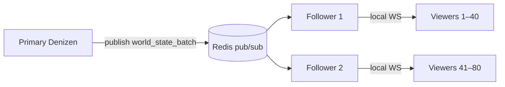

# Phase 5 Roadmap — llama.cpp, 100 viewers, durable Docker

> Follows completed Phase 4 (inference mesh, federation v1, bundled Ollama).

## Status overview

| Track | Goal | Status | Effort |
|-------|------|--------|--------|
| **A4** llama.cpp embed | De-risk Ollama dependency; air-gap inference | **Done** (fetch + wizard GGUF) | — |
| **D1** 100 WS viewers | Horizontal game spectators | Redis pub/sub scaffold | Full scale 1–2 wks |
| **B6** Docker rebuild | Stop hotfix-after-compose | Remote NAS build path | Ready to run |

---

## A4 — llama.cpp (llama-server binary) ✅

**Problem:** Ollama is external; some installs need a single shipped binary or no Ollama install.

**Strategy (A4b):** Ship `llama-server` from [llama.cpp](https://github.com/ggml-org/llama.cpp) — OpenAI-compatible `/v1/chat/completions`, same wire as LM Studio.

### Shipped (full A4)

| Piece | Location |
|-------|----------|
| `llamacpp` backend probe | `src/denizen-inference-runtime.js` (synced to desktop via `copy-denizen-src.js`) |
| Fetch at build | `desktop/scripts/fetch-llama-server.js` |
| Spawn helper | `desktop/llama-server-manager.js` |
| GGUF download | `desktop/llama-brain-pull.js` + wizard `pull-brain-model` |
| Catalog | `desktop/data/brain-catalog.json` (GGUF + Ollama entries) |
| extraResources | `resources/llama/` → installer |

### Build

```powershell
cd denizen/desktop
# Windows installer — downloads ~20MB llama-server CPU binary from GitHub releases
npm run prebuild:win
npm run build:win

# Optional variants
$env:LLAMACPP_VARIANT="vulkan"   # or cuda12, cuda13
$env:LLAMACPP_VERSION="b7525"
node scripts/fetch-llama-server.js
```

Set `OLLAMA_FETCH=1` separately to also bundle Ollama from a local install.

### Usage

```powershell
# Bundled path (after wizard download)
# llama-server starts on 127.0.0.1:8081 with downloaded GGUF

set LLAMACPP_URL=http://127.0.0.1:8081
set DENIZEN_INFERENCE_BACKEND=auto
```

`auto` order: LM Studio → Ollama → llama.cpp.

Models download to `%APPDATA%/Denizen/llama-models/` (userData).

---

## D1 — 100 WebSocket viewers / Redis

**Problem:** `world-state.js` is in-memory on one Node process. ~30–50 `/agent-ws` clients per instance; 100 concurrent office viewers need fan-out across nodes.

**Architecture (v1 scaffold):**



| Role | `DENIZEN_SERVER_ROLE` | Behavior |
|------|----------------------|----------|
| Primary | `primary` (default) | Owns simulation; publishes WS batches to Redis |
| Follower | `follower` | Subscribes; relays frames to local WS only (read replica) |
| Standby | `standby` | CRM/API only; no world sim |

### Env

```env
DENIZEN_WORLD_PUBSUB=redis          # memory (default) | redis
DENIZEN_REDIS_URL=redis://127.0.0.1:6379
DENIZEN_WORLD_PUBSUB_CHANNEL=denizen:world:broadcast
DENIZEN_SERVER_ROLE=primary         # primary | follower | standby
DENIZEN_MAX_WS_CLIENTS=100          # per instance cap
```

Install Redis client when enabling:

```bash
cd denizen && npm install redis
```

### Not in v1 scaffold (next)

- Sticky sessions at Cloudflare
- Single simulation leader election
- NPC think only on primary
- Supabase Realtime as Redis alternative

See [MESH_SCALING.md](MESH_SCALING.md) Phase 5.

**Gap closure plan:** [PHASE5_SCALE_BRIDGE.md](PHASE5_SCALE_BRIDGE.md) — sprints, tests, bug hunt checklist.

---

## B6 — Full Docker image rebuild

**Problem:** `docker compose up` recreates from image and wipes `hotfix-inference-mesh-nas.py` copies.

**Fix:** Build image with current source baked in.

### Option A — Local build (Docker Desktop)

```powershell
# Start Docker Desktop first
py infra/deploy-denizen-to-nas.py
```

### Option B — Remote build on NAS (no local Docker)

```powershell
py infra/deploy-denizen-to-nas.py --remote-build
# or
set SYNO_REMOTE_BUILD=1
py infra/deploy-denizen-to-nas.py
```

Uploads source tarball → `docker build` on Synology → `compose up`. No hotfix needed after recreate.

### After deploy

```powershell
py infra/probe-denizen-nas.py
curl https://denizen.dolonia.cloud/api/health
```

Verify `inference`, `federation`, `worldPubsub` blocks in health.

---

## Acceptance (Phase 5 complete)

1. Desktop installer can run inference via bundled `llama-server` without Ollama
2. Three Denizen followers + Redis serve 100+ spectators with sticky routing
3. `deploy-denizen-to-nas.py --remote-build` survives `compose up` with no hotfix
4. `/api/health` reports `worldPubsub.driver`, `ws.clients`, `ws.max`
