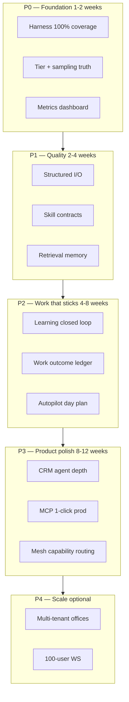

# Denizen → A+ Plan

**Date:** 2026-07-16  
**Goal:** Raise every product pillar from “works as a lab OS” to **A+** — reliable, measurable, operator-trustworthy, without rewriting the world.  
**Principle:** *Harness first, evidence second, autonomy last.* Code owns control flow; models fill slots; metrics prove A+.

---

## 0. Target grade card

| Pillar | Now | A+ definition (pass/fail) | North-star metric |
|--------|-----|---------------------------|-------------------|
| **A. Office observability** | A− | 16 NPCs stay lively under load; zero “dead office”; actions match skill/work evidence | p95 think latency; % decisions with real action ≠ wander; frame p95 ≥ 50fps |
| **B. Local multi-agent runtime** | B+ | Wrong-tier never answers hard Qs; harness on 100% local calls; structured think+chat | `harnessComplete / providerOk ≥ 0.95`; hard-Q main-tier hit rate ≥ 99% |
| **C. Skills / real work** | B | Top 15 skills have contracts, tests, cooldowns; success injected to MEMORY | skill success rate ≥ 85% / 7d; zero double-inject; report artifacts on disk |
| **D. CRM (Meridian)** | B+ | Operator completes “lead → deal → quote” without console; agents assist with truth | weekly active workspace; agent-attributed CRM mutations ≥ N/week |
| **E. BYO AI / MCP** | B | 1-click connect works on prod URL; scopes + rate limits; docs match reality | connect success ≥ 90% first try; 401s always advertise discovery |
| **F. Compute mesh / desktop** | B− | Capability-aware claim; credits correct; station skills reliable | job success ≥ 90%; wrong-node claims → 0; credit mismatch → 0 |
| **G. Unattended “run company”** | C+ | Supervised autopilot: daily brief + N completed work items with human gates | ≥ 5 real work outcomes / day with approval; 0 silent high-impact side effects |
| **H. Learning flywheel** | C+/B− | Consult → MEMORY → next think cites lesson; outcome scores improve | lessons applied / week; citation rate in think; prediction accuracy trend ↑ |
| **I. Reliability / ops** | B− | One-button health; no silent demo fallback; deploy without shamanism | uptime; demo-loop entries / week → 0; health issues auto-ticketed |

**A+ is not “smarter than Claude.”** A+ is: *always the right model, right tool, right evidence, measurable improvement, operator never surprised.*

---

## 1. Strategy (how experts get to A+)



**Rules of engagement**

1. **No OpenClaw resurrection** — Jelly = tools; harness = nervous system.
2. **No three fat models on 16GB** — dual-load Gemma FAST + Qwen MAIN/HEAVY; JIT only for experiments.
3. **Every epic has a kill metric** — if metric doesn’t move in 2 weeks, re-scope.
4. **Prefer thin facades over rewrites** — keep `npc-brains` prompt craft; route I/O through harness.
5. **Human gate on money, code apply, email send, trade** — A+ includes *control*, not only autonomy.

---

## 2. Phase 0 — Foundation (A+ runtime floor)

**Duration:** ~1–2 weeks  
**Owner focus:** harness, inference, observability

### 0.1 Harness coverage → 100%

| Task | Done when |
|------|-----------|
| Stream paths (`_callLocalStream`) also use harness or shared sampling | parity with non-stream |
| Computer-use / desktop-agent LM calls via `getActiveHarness()` | no raw POST left in those modules |
| Desktop twin `desktop/src/denizen-inference-runtime.js` shares profiles | same sampling + heavy tier |
| `/api/health` shows `harnessComplete`, tier mix, loaded models | operator can see gate is live |

### 0.2 Tier truth under VRAM

| Task | Done when |
|------|-----------|
| Startup probe: if MAIN pin unloaded, **fail loud** in health (not silent 2B) | `health.issues` includes `main_model_unloaded` |
| Per-NPC tier map (idle/bouncer → fast; Abby/Bob/hard → main) | config in `denizen-harness.json` |
| Context caps 8–16k on dual-load documented + LM Studio checklist | `docs/LM_STUDIO_HOST.md` one-pager |
| Optional draft model for speculative decoding | measured tok/s uplift or skip |

### 0.3 Office liveliness

| Task | Done when |
|------|-----------|
| Think cadence budget under queue saturation (skip ambient when depth high) | queue depth never unbounded; presence degrades first |
| Cofounder demo-loop: never silent — UI banner “director offline” | operator sees state |
| Stuck-loop / repeat detector drives rebalance (existing hooks) | repeat rate ↓ in telemetry |

**P0 exit criteria**

- [ ] Local call harness rate ≥ 95% for 48h  
- [ ] Hard player questions use ≥14B model ≥ 99%  
- [ ] No cofounder demo-loop without UI flag  
- [ ] Dual-load checklist reproducible on `.232`

---

## 3. Phase 1 — Quality (A+ brains, not bigger models)

**Duration:** ~2–4 weeks

### 1.1 Structured output everywhere that matters

| Surface | Schema | Fail mode |
|---------|--------|-----------|
| think | existing decision JSON | repair once → fallback decision |
| player/peer chat | `{ reply, tone?, next_action? }` | strip + length cap |
| skill args | per-skill input schema | reject + re-ask once |
| research brief | `{ summary, bullets[], sources[] }` | mark incomplete |

### 1.2 Skill contracts (Jelly A+)

Top skills first: `research`, `github`, `coding-agent`, `denizen-data`, `consult-grok`, `market-watch`, `job-pipeline`, `browserclaw`, `health-check`, `remediate`.

Each skill ships:

```
input_schema · timeout · cooldown · preferred_tier · output_shape · inject_template · test
```

**Done when:** `node --test tests/jelly-skills-*.test.js` green; skill success dashboard on `/api/harness`.

### 1.3 Retrieval memory (stop context bloat)

| Task | Done when |
|------|-----------|
| Embed MEMORY.md chunks via nomic (already have embedding worker) | top-k by query at think/chat |
| Cap chat history by tokens not turns | overflow errors ↓ 50% |
| Evidence ledger always preferred over free recall | hallucination-guard trips less |

### 1.4 Reasoning models used correctly

| Task | Done when |
|------|-----------|
| `enable_thinking` only on R1/reason models + hard kinds | latency budget documented |
| Strip think tags before speech/bubble | zero raw CoT in office UI |

**P1 exit criteria**

- [x] Chat structured parse path landed (`denizen-chat-schema` + wired in brains) — *measure &lt;2% live after soak*  
- [x] Retrieval memory top-k for think/chat (`denizen-memory-retrieve`) — *overflow soak still open*  
- [x] Top-10 skills have contracts + tests (`denizen-skill-contracts`, 83 A+ suite green)  
- [ ] Bouncer-style repetition gone under load test (sampling live; soak not complete)

---

## 4. Phase 2 — Work that sticks (A+ autonomy *supervised*)

**Duration:** ~4–8 weeks

### 2.1 Learning closed loop

```
telemetry friction → consult queue → mentor answer → MEMORY inject
  → next think must see [LESSON] → outcome scorer → improve log
```

| Task | Done when |
|------|-----------|
| Single learning module owns all injects (harness already) | one JSONL + DB dual-write |
| Think prompt *requires* citation of latest lesson when present | sample audit ≥ 60% cite rate |
| Before/after metric on consult domain | `consult-improvement-log` + dashboard |
| Intelligence spine facts for NPC work outcomes | every skill success → fact |

### 2.2 Daily company plan (autopilot that earns trust)

| Task | Done when |
|------|-----------|
| Abby generates “today’s 5 priorities” from CRM + office + inbox | visible board UI |
| Each priority becomes task-chain or directive | chain completion tracked |
| High-impact steps require approval (email, code apply, trade, deploy) | 0 silent side effects |
| End-of-day report artifact in `reports/` | CEO can skim in 2 min |

### 2.3 Evidence-backed speech

| Task | Done when |
|------|-----------|
| Grounding check: claims of “I shipped X” need evidence log | false claim rate ↓ |
| Work feed shows only evidence-backed items | UI trust |

**P2 exit criteria**

- [x] Daily plan skeleton + API (`GET/POST /api/daily-plan`, Abby inject)  
- [x] Lesson block in think + soft cite-to-save (`chatSchema` lessons)  
- [x] Evidence helper + thought-only grounding queue (`denizen-evidence`)  
- [ ] ≥ 5 evidence-backed work outcomes / day for 5 consecutive days *(ops metric)*  
- [ ] Lesson citation rate ≥ 60% when lessons pending *(ops metric)*  
- [ ] 0 high-impact actions without approval  
- [ ] Operator weekly review &lt; 15 minutes of reading

---

## 5. Phase 3 — Product pillars to A+

**Duration:** ~8–12 weeks (parallel tracks)

### 3.1 CRM (B+ → A+)

| Epic | Outcome |
|------|---------|
| Agent write paths for contact/deal/note with org policy | agents *mutate* CRM safely |
| Role-specific daily digest (SDR/AM/support) | push to office + email optional |
| Industry template smoke tests (top 5 industries) | CI |
| CRM MCP tools parity with UI | Cursor/Claude can work Meridian |

### 3.2 MCP / BYO AI (B → A+)

| Epic | Outcome |
|------|---------|
| Hosted connect URL documented + tested on denizen.dolonia.cloud | 1-click video + runbook |
| Consent + session handoff for cross-browser | no “same browser only” trap |
| Rate limit + scope matrix per tool | security A+ |
| Health: list connected clients | ops visibility |

### 3.3 Mesh / desktop (B− → A+)

| Epic | Outcome |
|------|---------|
| Capability-aware job claim (VRAM, GPU class, station vs headless) | right node, right job |
| Credit ledger reconciliation job | mismatch alerts |
| Station skill reliability SLA | desktop path flaky rate &lt; 5% |
| Streaming chat over mesh RPC | UX A+ for remote GPU |

### 3.4 Reliability / ops (B− → A+)

| Epic | Outcome |
|------|---------|
| Health runbook auto-remediate safe fixes | `remediate` skill gated |
| Single deploy script NAS + pin env check | no shaman deploy |
| Process supervision (PM2/systemd) + single-instance | restart safe |
| Public demo mode truly independent of LM Studio | marketing without lab |

**P3 exit criteria**

- [ ] PRD pillars A–E all green with linked metrics  
- [ ] First-run → first delegated real task &lt; 15 minutes  
- [ ] Mesh job success ≥ 90% over 7d  
- [ ] MCP connect first-try ≥ 90% on prod

---

## 6. Phase 4 — Scale (optional A+ for multi-user)

Only after P0–P3. From existing [GAP_CLOSURE_PLAN](GAP_CLOSURE_PLAN.md) / [MULTI_USER_OFFICE_PLAN](MULTI_USER_OFFICE_PLAN.md):

- WS shard / sticky sessions  
- Shared world-state pub/sub  
- DB-backed souls per org  
- Standby failover  

**Do not** start multi-tenant before supervised single-operator A+.

---

## 7. Hardware policy (fixed constraints)

**Box:** i9-14900KF, 64GB RAM, RTX 4070 Ti SUPER 16GB, water cooled, LM Studio @ 192.168.1.232.

| Mode | Load | Use |
|------|------|-----|
| **Daily A+ default** | Gemma FAST + Qwen MAIN=HEAVY @ 12–16k | Office + skills |
| **Quality burst** | Qwen only @ 32k | Long docs / dossiers |
| **Reasoning experiment** | Unload Gemma; load R1-class @ 8–12k | Hard planning only |
| **Never** | 3 mid/heavy models @ 64k+ | VRAM thrash |

Water cooling = sustained clocks under multi-hour loops, **not** free VRAM.

---

## 8. Measurement system (without this, “A+” is cosplay)

### 8.1 Single dashboard: `/api/harness` + office HUD

Surfaces:

- harness rate, tier histogram, model IDs loaded  
- queue depth p50/p95, think latency  
- skill success / fail by skill  
- consult backlog, lessons applied 24h  
- demo-loop flag, main_model_unloaded flag  
- work outcomes 24h  

### 8.2 Weekly scorecard (template)

| Metric | Target | Week N |
|--------|--------|--------|
| harness rate | ≥ 0.95 | |
| hard-Q main tier | ≥ 0.99 | |
| skill success | ≥ 0.85 | |
| evidence work / day | ≥ 5 | |
| lesson cite rate | ≥ 0.60 | |
| demo-loop events | 0 | |
| mesh job success | ≥ 0.90 | |
| high-impact ungated | 0 | |

### 8.3 Acceptance tests (automate)

- `tests/denizen-harness.test.js` (exists)  
- Load test: 16 NPCs 30 min, assert queue bound  
- Skill contract suite top-10  
- MCP OAuth smoke (staging)  
- CRM lead→deal happy path e2e  

---

## 9. Sequencing (what to build next, in order)

| Sprint | Focus | Delivers |
|--------|-------|----------|
| **S1** | P0.1–0.3 | Harness 100%, health flags, liveliness under load |
| **S2** | P1.1–1.2 | Structured chat; 5 skill contracts |
| **S3** | P1.3–1.4 + P2.1 | Retrieval memory; learning cite metric |
| **S4** | P2.2–2.3 | Daily plan + evidence speech |
| **S5–S6** | P3 CRM + MCP | Agent CRM depth; 1-click prod |
| **S7–S8** | P3 mesh + ops | Capability routing; deploy runbook |
| **S9+** | P4 if needed | Multi-user only if single-op A+ holds |

Rough calendar: **~8–12 weeks** to product A+ for solo operator; scale after.

---

## 10. What we will *not* do (anti-goals)

| Temptation | Why not |
|------------|---------|
| Fork OpenClaw | Wrong product shape; already evaluated |
| Fine-tune first | Harness + data quality first; LoRA in P2+ only |
| Rewrite `npc-brains` monolith | Thin + route; rewrite later if metrics stuck |
| Max context everywhere | Kills 16GB dual-load |
| Full unattended CEO | Trust requires gates; “supervised autopilot” is A+ |
| Chase 100 tenants early | Focus risk (PRD R6) |

---

## 11. Immediate next sprint (S1) — concrete backlog

1. **Harness stream parity** — `_callLocalStream` + computer-use via `complete`/`getActiveHarness`  
2. **Health: `main_model_unloaded` + harness rate** on `/api/health` and `/api/harness`  
3. **Per-NPC tier map** in `config/denizen-harness.json`  
4. **Cofounder offline banner** when demo-loop or consecutive errors ≥ 3  
5. **LM Studio host runbook** (pins, ctx 12–16k, keep loaded, dual model)  
6. **30-min load test script** + baseline numbers written to `reports/harness/`  

**S1 exit:** green weekly scorecard row for runtime metrics; operator can prove dual-load A+ floor.

---

## 12. Success narrative (how we know we’re done)

You open Denizen on a normal morning:

1. Health is green: Qwen+Gemma loaded, harness rate 99%, queue calm.  
2. Abby’s board shows 5 priorities grounded in CRM + overnight consults.  
3. Lucy/Bob/Alex execute skills that leave artifacts + CRM facts.  
4. You approve one email and one code proposal; nothing else side-effects.  
5. Evening report cites lessons learned; next day thinks reference them.  
6. You spent &lt; 15 minutes steering and still feel in control.

That is **A+ Denizen** — not magic AGI, but the operating layer you advertised, delivered.

---

## Related docs

- [DENIZEN_HARNESS.md](DENIZEN_HARNESS.md)  
- [LOCAL_HARNESS_UPGRADE.md](LOCAL_HARNESS_UPGRADE.md)  
- [GAP_CLOSURE_PLAN.md](GAP_CLOSURE_PLAN.md)  
- [INTELLIGENCE_SPINE.md](INTELLIGENCE_SPINE.md)  
- [PRD.md](PRD.md)  
- [ROADMAP.md](ROADMAP.md)  
- [HARNESS_EVALUATION.md](HARNESS_EVALUATION.md)  
