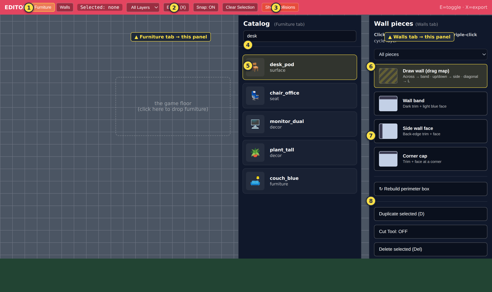

# Editor Panel Reference — what every button does

This is the panel that opens when you press **`E`** in the game
(`http://localhost:8080/`). The image below shows **both side panels at once**
for reference — in the real game you see **one at a time**: the **Furniture**
tab shows the Catalog panel, the **Walls** tab shows the Wall pieces panel.

> The art and labels above are reproduced 1:1 from the real editor markup in
> `office-scene.js`, so the buttons match what you'll see on screen.

## What each number is

| # | Control | What it does |
|---|---------|--------------|
| **1** | **Furniture / Walls tabs** | Switch what you're editing. Furniture = place objects. Walls = draw the room outline & boundaries. The active tab decides which side panel shows and what **`X`** exports. |
| **2** | **Export (X)** | Save the **active tab**. Furniture → layout saved to the live game + a backup `.json` downloads. Walls → `openplan_walls_edited.json` downloads. Same as pressing **`X`**. |
| **3** | **Show Collisions** | Toggle the invisible boundaries. **Red** boxes = solid things that block movement. **Blue** cells = squares characters can't walk on. Your check that walls/paths are right. |
| **4** | **Search box** | *(Furniture tab)* Type part of a name (`desk`, `plant`) to filter the catalog. Only **named** items appear here. |
| **5** | **Catalog item** | *(Furniture tab)* Click one (it highlights yellow), then **click the floor** to drop it. Drag also works. **Double-click a placed piece** on the floor to delete it. |
| **6** | **Draw wall** | *(Walls tab)* The main wall tool. Drag on the floor: **across → top "band" wall**, **up/down → side wall**, **diagonal → an L-corner** (band + side + cap together). |
| **7** | **Wall piece buttons** | *(Walls tab)* Drop one specific piece instead of dragging: **Wall band** (horizontal), **Side wall face** (vertical), **Corner cap**, **T-junction** (where three walls meet). |
| **8** | **Wall actions** | *(Walls tab)* **Rebuild perimeter box** = instant clean rectangle room (great starting point). **Duplicate (D)**, **Cut Tool (K)** = split a wall to make a doorway, **Delete (Del)**, **Export walls JSON (X)**. |

## Other toolbar bits (not numbered)

- **Selected: none** — shows the id of whatever piece you've clicked.
- **All Layers** dropdown — dim everything except one type (desks, chairs, decor…) so you can focus on one kind of object.
- **Snap: ON** — keeps pieces aligned to the grid. Leave it **on** for straight walls and tidy desk rows.
- **Clear Selection** — deselect the current piece.

## The three-step build, in this panel

1. **Walls tab** → ⑧ *Rebuild perimeter box*, then ⑥ draw or ⑦ drop pieces; `K` cuts doorways. ③ *Show Collisions* to verify boundaries.
2. **Furniture tab** → ④ search, ⑤ click an item then click the floor. Repeat.
3. Press **`X`** (② Export) on **each** tab to save.

See [SCENE_BUILDING_MANUAL.md](SCENE_BUILDING_MANUAL.md) for the full workflow and
[QUICK_START_PRINTABLE.md](QUICK_START_PRINTABLE.md) for the one-page version.
