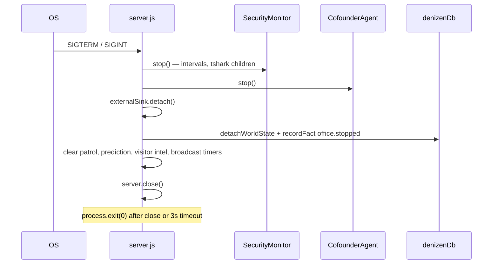

# Denizen — HTTP & WebSocket Server

This document describes [server.js](../server.js) — the monolithic Node process that serves the Phaser client, routes every `/api/*` endpoint, and hosts the real-time WebSocket channels. For how those pieces fit the wider system, see [ARCHITECTURE.md](ARCHITECTURE.md).

## One-sentence summary

A single ~7,700-line `http.createServer` handler that boots every subsystem (security monitor, NPC brains, Jelly skills, compute mesh, visitor DB), delegates `/api/compute/*` and `/api/desktop/*` to a mounted module, and multiplexes two WebSocket upgrade paths — `/agent-ws` for the office and `/security-ws` for threat visualization.

## Role of server.js

| Property | Value |
|---|---|
| File | [server.js](../server.js) |
| Line count | ~7,714 (as of 2026-06-08) |
| Entry | `node server.js` from `denizen/` |
| Default port | `8080` (`PORT` env) |
| Static root | `denizen/` (`__dirname`) |

`server.js` is intentionally monolithic: one `http.createServer` callback contains ~150 inline route matchers, the full `/agent-ws` message dispatcher (player chat, think loop, Bouncer tools, visitor handoffs), world-state broadcast throttling, and graceful shutdown. Extraction is incremental — compute/desktop routes already live in [denizen-compute-routes.js](../src/denizen-compute-routes.js); market/intelligence duplicates exist in [route-registry.js](../src/route-registry.js) but are **not wired** (see below).

```
┌─────────────────────────────────────────────────────────────────────────┐
│                         server.js (monolith)                            │
│                                                                         │
│  load-env → imports (~70 modules) → subsystem init → createServer       │
│       │                              │                                  │
│       │    ┌─────────────────────────┼─────────────────────────┐        │
│       │    ▼                         ▼                         ▼        │
│       │ SecurityMonitor          NpcBrainManager          CofounderAgent│
│       │    + /security-ws            │                    + /agent-ws   │
│       │                              ├── Jelly (createJelly)           │
│       │                              ├── mountComputeRoutes ────────────┼──► denizen-compute-routes.js
│       │                              ├── denizenDb / visitor / intel    │
│       │                              └── inline /api/* matchers         │
│       ▼                                                                 │
│  static files (index.html, assets/, src/)                               │
└─────────────────────────────────────────────────────────────────────────┘
```

## Startup sequence

Initialization happens in two phases: **module evaluation** (before `listen`) and **`server.listen` callback** (after the port binds).

### Phase 1 — module load (synchronous, top to bottom)

| Order | What runs | Notes |
|---|---|---|
| 1 | `require('./src/load-env')` | Loads `denizen/.env` without overriding shell vars |
| 2 | ~70 module imports | Brains, visitor, compute, Jelly, telemetry, etc. |
| 3 | Voice map load | `data/voice-map.json` + roster merge |
| 4 | `SecurityMonitorServer` | `securityMonitor.start()` — file/network polling begins |
| 5 | `NpcBrainManager` + `CofounderAgent` | Brains constructed; director wired to brains |
| 6 | `mountComputeRoutes({...})` | Returns `handleComputeRoutes`; hardware sampler starts inside module |
| 7 | Host hardware loop | `hardwareMonitor.startHostSampler` → `fleetRegistry` |
| 8 | `computeSettlement.startSettlementLoop` | Credit settlement ticker |
| 9 | `computeProducer.startMeshJobProducer` | Auto-enqueues mesh jobs when fleet env is set |
| 10 | Broadcast wiring | `npcBrains.setBroadcast`, `pcActivity.setBroadcast` → `/agent-ws` clients |
| 11 | `createJelly({...})` | Skill runtime; approved-skill cache |
| 12 | `ExternalSink.attach()` | Outbound webhooks (no-op without env) |
| 13 | `denizenDb.attachWorldState(worldState)` | Facts mirror from world mutations |
| 14 | World-state throttle | `worldState.on('change')` → 500 ms batched `world_state_batch` |
| 15 | `http.createServer(handler)` | Request router defined (not listening yet) |
| 16 | WebSocket servers | `securityWss`, `agentWss` (`noServer: true`) + message handlers |
| 17 | `server.on('upgrade')` | Routes `/security-ws`, `/agent-ws`; optional OpenClaw proxy |
| 18 | `startResearchScheduler({...})` | Job CRM maintenance, research queue, daily digest |
| 19 | `_resetLucyBrowserOnStartup()` | Kills orphan Playwright children from prior run |
| 20 | `_startLucyMirrorFrameWatcher()` | File watcher for browser mirror frames |

### Phase 2 — `server.listen(PORT)` callback

| Order | What runs | Notes |
|---|---|---|
| 1 | `denizenDb.init()` | Supabase connection; on success → memory refresh, prediction maintenance |
| 2 | `runPredictionMaintenance` + 6 h interval | [INTELLIGENCE_SPINE.md](INTELLIGENCE_SPINE.md) |
| 3 | `startVisitorIntelligenceLoop` | Briefings, proactive triggers, recurring tasks |
| 4 | `npcBrains.syncLmStudioModel()` | Probes LM Studio; sets active model on brains + cofounder |
| 5 | `cofounderAgent.start()` or demo loop | Economy mode skips LLM when `DENIZEN_COFOUNDER_LLM` unset |
| 6 | Bouncer patrol timer | First run after 60 s, then every 5 min via `linuxAgent.perimeterPatrol` |

On `EADDRINUSE`, the server attempts to kill the process holding the port and retries once after 1 s (Windows: `netstat` + `taskkill`; Linux: `fuser`/`lsof`).

## HTTP route inventory

Every request passes `securityMonitor.checkHttpRequest(req)` first. Routes are matched in declaration order inside the `createServer` callback — visitor auth and compute paths are intentionally early.

### Visitor & session

| Method | Path | Purpose |
|---|---|---|
| GET | `/api/visitor/ping` | Liveness probe |
| GET/POST | `/api/visitor/access/verify` | Team/CEO access code verification |
| GET | `/api/visitor/session/open` | Session open via headers (tunnel-safe) |
| POST | `/api/visitor/auth/register` | Team account registration |
| POST | `/api/visitor/auth/login` | Team login |
| POST/GET | `/api/visitor/session` | Create or fetch session |
| GET | `/api/visitor/org` | Org metadata by slug |
| GET/PATCH | `/api/visitor/assistant` | Assistant persona for session |
| POST | `/api/visitor/claim` | Claim assistant / onboarding step |
| GET/POST | `/api/visitor/projects` | Project list / create |
| PATCH/DELETE | `/api/visitor/projects/:id` | Update / delete project |
| GET | `/api/visitor/teammates` | Teammates + WS presence |
| POST | `/api/visitor/handoff`, `/api/visitor/handoffs` | Assistant handoff to CEO or peer |
| GET | `/api/visitor/handoffs` | Pending handoffs |
| POST | `/api/visitor/handoffs/:id/delivered` | Mark handoff delivered |
| PATCH | `/api/visitor/handoffs/:id` | Alternate delivered marker |
| GET | `/api/visitor/briefing` | Morning briefing (team feature) |
| GET/PATCH | `/api/visitor/profile` | Deep profile + Slack webhook |
| GET/POST | `/api/visitor/commitments` | Open commitments |
| POST | `/api/visitor/commitments/:id/resolve` | Resolve commitment |
| GET/POST | `/api/visitor/recurring-tasks` | Scheduled prompts |
| GET | `/api/visitor/research` | Cited research (`?q=`) |
| POST | `/api/visitor/slack/link` | Link Slack webhook to session |
| POST | `/api/visitor/slack/inbound` | Slack Events API relay |
| GET | `/api/orgs` | List organizations |
| GET | `/api/org/policy` | Org policy settings |
| GET/POST | `/api/assistant-profile` | Legacy assistant profile |
| GET/POST | `/api/presence` | CEO keyboard presence flag |

See [VISITOR_ONBOARDING.md](VISITOR_ONBOARDING.md).

### Compute & desktop

Delegated to `handleComputeRoutes` from [denizen-compute-routes.js](../src/denizen-compute-routes.js) when `urlPath.startsWith('/api/compute/')` or `/api/desktop/`.

| Method | Path | Purpose |
|---|---|---|
| GET/POST | `/api/compute/node/register` | Register mesh worker node |
| GET/POST | `/api/compute/node/heartbeat` | Node liveness + metrics |
| GET/POST | `/api/compute/node/claim` | Claim next queued job |
| GET/POST | `/api/compute/node/complete` | Complete or fail job |
| GET | `/api/compute/node/status` | Node status |
| POST | `/api/compute/node/opt-in` | Opt into contribution |
| GET | `/api/compute/hardware/live` | Live fleet hardware snapshot |
| GET | `/api/compute/fleet/agent-bundle.tar.gz` | NAS fleet agent bundle (token-gated) |
| GET/POST | `/api/compute/fleet/report` | Fleet agent metrics report |
| GET | `/api/compute/contribution/summary` | Contribution ledger summary |
| GET | `/api/compute/credits/economy` | Credit economy config |
| GET/POST | `/api/compute/credits/spend` | Spend credits |
| GET/POST | `/api/compute/jobs/enqueue` | Enqueue mesh job (internal token) |
| GET/POST | `/api/desktop/pairing/create` | Desktop pairing QR/session |
| GET | `/api/desktop/pairing/claim` | Claim pairing code |
| GET/POST | `/api/desktop/permission/request` | Permission prompt to CEO |
| GET | `/api/desktop/permission/pending` | Pending permissions |
| GET/POST | `/api/desktop/permission/respond` | Approve/deny permission |
| GET/POST | `/api/desktop/wizard/complete` | Onboarding wizard completion |
| GET/POST | `/api/desktop/capabilities/sync` | Capability sync from desktop app |
| GET/POST | `/api/desktop/feedback` | Desktop UX feedback |
| GET | `/api/desktop/feedback/recent` | Recent feedback entries |
| POST | `/api/desktop/register` | Register desktop install |

Also inline in `server.js` (not in compute module):

| Method | Path | Purpose |
|---|---|---|
| POST | `/api/desktop-task` | Run desktop agent task |
| POST | `/api/desktop-abort` | Abort in-flight desktop task |

See [COMPUTE_MESH.md](COMPUTE_MESH.md).

### Proposals & self-advancement

| Method | Path | Purpose |
|---|---|---|
| GET | `/api/proposals` | Aggregated operator review queue |
| GET | `/api/npc-capabilities` | All NPC capability cards |
| GET | `/api/npc-capabilities/:name` | Single NPC capabilities |
| GET | `/api/capability-proposals` | Capability request queue |
| POST | `/api/capability-proposal/approve` | Approve/reject capability |
| POST | `/api/request-capability` | NPC submits capability request |
| POST | `/api/soul-proposal` | NPC SOUL revision proposal |
| GET | `/api/soul-proposals` | List SOUL proposals |
| POST | `/api/soul-proposal/approve` | Approve/reject SOUL |
| POST | `/api/soul-proposal/apply` | Apply approved SOUL to disk |
| POST | `/api/request-animation` | NPC animation request |
| GET | `/api/animation-proposals` | Animation queue |
| POST | `/api/animation-proposal/approve` | Approve/reject animation |
| GET | `/api/skill-proposals` | Jelly skill proposals |
| POST | `/api/skill-proposals/:id/approve\|reject` | Skill approve/reject |
| GET | `/api/code-proposals` | NPC code proposals |
| POST | `/api/code-proposals/:id/approve\|reject` | Code approve/reject |

See [PROPOSAL_REVIEW.md](PROPOSAL_REVIEW.md), [SOUL_REFLECTION.md](SOUL_REFLECTION.md), [ANIMATION_FORGE.md](ANIMATION_FORGE.md).

### Intelligence & federal pipeline

| Method | Path | Purpose |
|---|---|---|
| GET | `/api/intelligence/prediction-summary` | Forecast rollup for briefings |
| GET | `/api/intelligence/mirofish-status` | MiroFish availability |
| POST | `/api/intelligence/mirofish-sync` | Trigger MiroFish maintenance |
| GET | `/api/federal/pipeline-summary` | RFP pipeline summary |

See [INTELLIGENCE_SPINE.md](INTELLIGENCE_SPINE.md), [MIROFISH_PREDICTION.md](MIROFISH_PREDICTION.md), [FEDERAL_PIPELINE.md](FEDERAL_PIPELINE.md).

### Lucy, email, jobs & research

| Method | Path | Purpose |
|---|---|---|
| POST | `/api/lucy-search` | Headed browser search |
| POST | `/api/lucy-job-pipeline` | Job board pipeline |
| GET | `/api/lucy-browser/mirror` | Browser mirror state |
| GET | `/api/lucy-browser/live-frame` | Latest mirror PNG/JPEG |
| GET | `/api/lucy-browser/stream` | MJPEG fallback |
| GET | `/api/lucy-browser/frame` | Latest PNG frame |
| POST | `/api/lucy-browser/close` | Close browser |
| POST | `/api/lucy-browser/input` | Remote scroll/tap |
| GET/POST | `/api/npc-browser/:npc/...` | Generic NPC browser mirror API |
| POST | `/api/open-brave` | Launch CEO Brave browser |
| POST | `/api/screen-observe` | Screenshot + vision |
| POST | `/api/email-inbound` | Inbound email webhook |
| GET | `/api/email-drafts` | Pending email drafts |
| POST | `/api/email-draft/send` | Send draft |
| GET | `/api/job-crm` | Job CRM state |
| GET | `/api/job-crm/standup` | Standup summary |
| POST | `/api/job-crm/maintenance` | CRM maintenance |
| POST | `/api/job-crm/referral` | Referral intake |
| POST | `/api/job-apply` | Submit job application |
| GET/POST | `/api/research-queue` | Research topic queue |
| POST | `/api/research-brief` | Generate research brief |
| POST | `/api/lucy-research-chain` | Multi-step research chain |
| POST | `/api/lucy-job-research-chain` | Job-focused research chain |
| POST | `/api/away/digest` | Away digest to CEO |
| POST | `/api/away/research/run` | Run away research |
| GET | `/api/research` | Web research (`webResearch` module) |

See [EMAIL_INTEGRATION.md](EMAIL_INTEGRATION.md), [JOB_CRM.md](JOB_CRM.md).

### Office, NPC ops & meetings

| Method | Path | Purpose |
|---|---|---|
| GET/POST | `/api/layout` | Office layout save/load |
| POST | `/api/place-furniture` | Place furniture + WS broadcast |
| POST | `/api/remove-furniture` | Remove furniture |
| POST | `/api/assign-directive` | Push mandatory NPC task |
| POST/GET | `/api/task-chains` | Start/list task chains |
| GET | `/api/task-chains/:id` | Chain status |
| POST | `/api/grant-permission` | CEO grants blocked NPC permission |
| GET/POST | `/api/meeting` | Meeting runner status/start |
| GET | `/api/ambient-dialogue/pair` | Scripted NPC dialogue pair |
| GET | `/api/office-config` | Client tuning config |
| POST | `/api/agent-bus` | External poke to NPC via agent bus |
| POST | `/api/task-update` | n8n/Supabase task webhook → worldState |
| GET | `/api/world-state` | Read-only world snapshot |

See [WORLD-STATE.md](WORLD-STATE.md), [AGENT_BUS.md](AGENT_BUS.md).

### Security & Bouncer

| Method | Path | Purpose |
|---|---|---|
| POST | `/api/bouncer-scan` | Manual nmap/wireshark/zenmap |
| POST | `/api/bouncer-linux` | Kali WSL investigation |
| GET | `/security-test` | Simulate threat (`?type=&severity=&detail=`) |

See [SECURITY.md](SECURITY.md).

### MCP & NPC sync

| Method | Path | Purpose |
|---|---|---|
| * | `/mcp/npc/:npcKey` | Per-NPC MCP HTTP gateway |
| GET | `/api/npc-sync/openapi.json` | OpenAPI spec for sync API |
| GET | `/api/npc-sync/status\|memory\|activity` | REST sync endpoints |
| POST | `/api/mcp/tokens` | Issue MCP bearer token |
| GET | `/api/mcp/connect-info` | Client connection instructions |
| GET | `/api/mcp/servers` | Configured MCP servers |
| GET | `/api/mcp/discover` | Discover all MCP servers |
| GET | `/api/mcp/servers/:id/tools` | List tools for server |

See [NPC_MCP_GATEWAY.md](NPC_MCP_GATEWAY.md).

### Market (Robinhood)

| Method | Path | Purpose |
|---|---|---|
| GET | `/api/market/auth-status` | OAuth status |
| GET | `/api/market/auth/connect` | Start OAuth |
| GET | `/api/market/auth/callback` | OAuth callback |
| GET | `/api/market/quote` | Stock quotes |
| GET | `/api/market/portfolio` | Portfolio |
| GET | `/api/market/positions` | Positions |
| GET/POST | `/api/market/watchlist` | Watchlist CRUD |
| GET | `/api/trade-suggestions` | Trade suggestions |
| POST | `/api/trade-suggestions/:id/dismiss` | Dismiss suggestion |

See [ROBINHOOD_LIVE.md](ROBINHOOD_LIVE.md).

### Telemetry, voice & health

| Method | Path | Purpose |
|---|---|---|
| GET | `/api/health` | LM Studio, providers, WS clients, hardware, visitor flags |
| GET | `/api/tts/health` | ElevenLabs configured? |
| POST | `/api/tts` | Server-side TTS stream (MP3) |
| GET | `/api/stt/health` | Whisper STT configured? |
| POST | `/api/stt` | Transcribe audio (base64) |
| GET | `/api/telemetry/llm` | Recent LLM events |
| GET | `/api/telemetry/llm/stats` | LLM stats window |
| GET | `/api/telemetry/llm/errors` | Recent LLM errors |
| GET | `/api/telemetry/llm/decisions` | Decision telemetry |
| GET | `/api/telemetry/insights` | Aggregated insights |
| GET | `/api/telemetry/cost` | Cost rollup |
| GET | `/api/telemetry/parse-health` | JSON parse repair rate |
| GET | `/api/telemetry/grounding` | Hallucination guard stats |
| GET | `/api/npc-profiles` | Per-NPC cost profiles |
| GET/POST | `/api/telemetry/openclaw` | OpenClaw telemetry ingest |
| GET | `/api/telemetry/openclaw/stats` | OpenClaw stats |
| GET | `/api/pc-activity` | PC activity log |
| GET | `/api/pc-activity/stats` | Activity stats |
| GET | `/api/pc-activity/active` | In-flight PC tasks |
| GET | `/api/costs` | Cost projector summary |

See [VOICE.md](VOICE.md), [VOICE_INPUT.md](VOICE_INPUT.md).

### City generator & static

| Method | Path | Purpose |
|---|---|---|
| POST | `/api/llm-city-plan` | LLM/heuristic city zones |
| GET | `/api/generate-city` | Full city chunk JSON |
| GET | `/`, `/index.html` | Phaser client (also `/denizen/`, `/pixel-office-game/` aliases) |
| GET | `/*` | Static files under `denizen/` with traversal guard |

Optional proxy when `JELLY_ENABLE_OPENCLAW_GATEWAY=true`: `/openclaw/*` → `127.0.0.1:18792`. See [OPENCLAW_INTEGRATION.md](OPENCLAW_INTEGRATION.md).

## WebSocket endpoints

Upgrade routing uses pathname only (query strings stripped for Cloudflare/nginx compatibility).

| Path | Server object | Purpose |
|---|---|---|
| `/agent-ws` | `agentWss` | Office channel — NPC brains, player chat, world state, cofounder commands |
| `/security-ws` | `securityWss` | Threat events → robber visualization |
| *(optional)* | TCP proxy | OpenClaw gateway at `127.0.0.1:18792` when `JELLY_ENABLE_OPENCLAW_GATEWAY=true` |

> **Note:** Older docs sometimes say `/ws`; the live endpoint is **`/agent-ws`** (see [chat-bootstrap.js](../src/chat-bootstrap.js)).

### `/agent-ws` — client → server

| Type | Payload (key fields) |
|---|---|
| `visitor_register` | `{ session_id?, is_ceo?, display_name? }` — binds WS to visitor session |
| `npc_think` | `{ npcName, context? }` — triggers `NpcBrainManager.think()` |
| `npc_conversation` | `{ npcName, fromName, text, turn }` — ambient dialogue (scripted, no LLM) |
| `player_chat` | `{ npcName, text, session_id?, isIncidentReport? }` — CEO/visitor talks to NPC |
| `npc_assign_directive` | `{ from, to, task, urgent? }` — manager pushes task |
| `npc_introduce` | `{ npcName, context? }` — tour introduction line |
| `npc_addressed` | `{ target, from?, text?, ts? }` — conversation focus mirror |
| `player_idle` | `{ idleMs, position? }` — receptionist tour trigger |
| `client_profile` | `{ touch?, ... }` — mobile client metadata |
| `bouncer_run_tool` | `{ tool, threat }` — nmap/wireshark via Kali |
| `bouncer_run_linux` | `{ threat, openTerminal? }` — full WSL investigation |
| `office_state` | `{ agents[], furniture[], tasks[], time }` — cofounder director input |

Unhandled types fall through to `cofounderAgent.handleClientMessage(msg)`.

### `/agent-ws` — server → client (selected)

| Type | When |
|---|---|
| `npc_decision` | Think loop result |
| `npc_response` | Conversation / introduction reply |
| `npc_cascade` | Leader decision rippling to reports |
| `npc_work_output` | Task phase updates during think |
| `player_chat_response` | Player chat reply |
| `player_chat_ack` | Queue depth ack before LLM |
| `directive_assigned` | Directive push confirmation |
| `assistant_handoff` | Visitor → CEO handoff alert |
| `agent_command` / `agent_commands` | Cofounder director orders |
| `world_state` | Immediate kind (`presence`, `threat`, `threat-cleared`) |
| `world_state_batch` | Throttled 500 ms coalesced deltas + agent-bus messages |
| `furniture_placed` / `furniture_removed` | Layout mutations |
| `npc_skill_start` / `npc_skill_result` | Jelly skill lifecycle |
| `npc_report_to_ceo` | Work output / search brief / digest |
| `desktop_permission_pending` | Desktop permission gate |
| `bouncer_tool_status` / `bouncer_linux_status` / `bouncer_linux_result` | Security tool progress |
| `bouncer_patrol_result` | Scheduled perimeter scan |
| `bouncer_player_order` | Player-ordered honeypot/confront |
| `bouncer_security` | Incident report speech |
| `lucy_browser_mirror` / `lucy_browser_frame` / `npc_browser_mirror` / `npc_browser_frame` | Browser mirror stream |
| `research_brief_done` / `research_queue_update` / `daily_digest_sent` | Research pipeline |
| `job_crm_event` / `lucy_job_pipeline_done` | Job CRM |
| `npc_email_arrived` | Inbound email |
| `npc_permission_granted` | CEO granted permission |
| `skill_proposal_decided` | Skill approve/reject |
| `npc_code_proposal_approved` / `npc_code_proposal_rejected` | Code proposal |
| `market_auth_connected` | Robinhood OAuth complete |
| `pc_activity` | Desktop/linux/web task fan-out |
| `threat` | Also on `/security-ws` (via security monitor) |

A 15 s interval polls pending handoffs and proactive intelligence events per connected visitor session.

### `/security-ws` — server → client

| Type | Payload |
|---|---|
| `threat` | `{ threatId, category, severity, source, target, detail, timestamp }` |
| `threat-cleared` | `{ threatId }` |
| `heartbeat` | `{ timestamp }` |

Full catalog: [SECURITY.md](SECURITY.md).

## route-registry.js vs inline server.js

[route-registry.js](../src/route-registry.js) exports `createDenizenRouteHandler` and `registerDenizenRoutes` — a **pluggable matcher** intended to shrink `server.js` over time. It handles:

| Route | Handler source |
|---|---|
| `/api/intelligence/*` | Delegates to [routes/intelligence-routes.js](../src/routes/intelligence-routes.js) if present |
| `GET /api/intelligence/prediction-summary` | `prediction-routes` or `getPredictionSummary` fallback |
| `GET /api/federal/pipeline-summary` | `federal-pipeline` module |
| `GET/POST /api/market/quote`, `/watchlist`, `POST /api/market/trade` | `robinhood-mcp` |
| `POST /api/job-crm/maintenance` | `job-crm.runMaintenance` |

**Current wiring:** `routeRegistry.registerDenizenRoutes` is **commented out** in `server.js` (~line 1931) to avoid broad churn. The same routes (except `POST /api/market/trade`) are implemented **inline** in `server.js` today. Intelligence mirofish routes exist in both places — inline handlers run first and match before any registry would.

[denizen-compute-routes.js](../src/denizen-compute-routes.js) is the opposite pattern: **actively mounted** via `mountComputeRoutes()` and called early for `/api/compute/*` and `/api/desktop/*`.

## Environment variables

Loaded from `denizen/.env` via [load-env.js](../src/load-env.js) (shell vars win). Template: [.env.production.template](../.env.production.template).

### Server core

| Variable | Default | Effect |
|---|---|---|
| `PORT` | `8080` | HTTP + WebSocket listen port |
| `DENIZEN_URL` / `DENIZEN_PUBLIC_URL` | `http://localhost:PORT` | Public base for MCP OpenAPI, connect-info |
| `LM_STUDIO_URL` | `http://localhost:1234` | Health probe + brain provider |
| `LM_STUDIO_PARALLEL` | `1` | Logged at boot; queue parallelism hint |
| `DENIZEN_COFOUNDER_LLM` | — | When set truthy, economy mode still runs real cofounder LLM |

### Database & visitor

| Variable | Effect |
|---|---|
| `SUPABASE_URL`, `SUPABASE_SERVICE_ROLE_KEY`, `SUPABASE_ANON_KEY`, `SUPABASE_DB_URL` | `denizenDb.init()` — sessions, facts, compute queue |
| `DENIZEN_CEO_IDENTITY_EMAIL` | CEO principal identity on session open |
| `RESEND_API_KEY`, `DENIZEN_EMAIL_FROM` | Visitor email notifications |
| `DISCORD_VISITOR_WEBHOOK_URL` | New-user Discord alert |

### Compute mesh

| Variable | Effect |
|---|---|
| `DENIZEN_INTERNAL_API_TOKEN` | Protects `POST /api/compute/jobs/enqueue` |
| `DENIZEN_FLEET_AGENT_TOKEN` | NAS fleet agent bundle + report auth |
| `DENIZEN_FLEET_IDENTITY_ID` | Host identity for contribution samples |
| `DENIZEN_SETTLEMENT_INTERVAL_MS` | Credit settlement loop interval |
| `DENIZEN_MESH_JOBS` / `DENIZEN_MESH_JOBS_INTERVAL_MS` | Mesh job producer (see template) |
| `DENIZEN_FLEET_PROBE_URLS`, `DENIZEN_NAS_AGENT_HEALTH_URL` | Auxiliary fleet probes |

### Jelly, Lucy & OpenClaw

| Variable | Default | Effect |
|---|---|---|
| `JELLY_ENABLE_OPENCLAW_GATEWAY` | `false` | Enable `/openclaw` HTTP + WS proxy |
| `OPENCLAW_ROOT` | `../openclaw` | Jelly OpenClaw skill fallback root |
| `LUCY_BROWSER_UNTIL_CLOSE` | `true` | Keep Playwright open until CEO says close |
| `LUCY_SEARCH_LINGER_MS` | `240000` | Auto-close delay when until-close is false |
| `LUCY_BROWSER_MODE` | `auto` | Browser launcher selection |
| `SOUL_PROPOSALS_PATH` | `data/soul-proposals.json` | SOUL proposal file (tests override) |

### Voice, STT, integrations

| Variable | Effect |
|---|---|
| `ELEVENLABS_API_KEY` | Server-side TTS (`/api/tts`) |
| `OPENAI_WHISPER_API_KEY` / `OPENAI_API_KEY` | STT (`/api/stt`) |
| `OPENAI_WHISPER_MODEL`, `OPENAI_WHISPER_BASE_URL` | Whisper config |
| `EMAIL_INBOUND_SECRET` | Validates `/api/email-inbound` |
| `ROBINHOOD_API_TOKEN` | Market quotes (OAuth optional) |
| `MIROFISH_ENABLED`, `MIROFISH_BASE_URL` | Prediction sync |
| `CITY_PLAN_PROVIDER` | `/api/llm-city-plan` provider override |
| `BOUNCER_INVESTIGATION_COOLDOWN_MS` | `900000` — dedup Bouncer scans |
| `DEBUG_TTS` | Log voice resolution per request |

External webhook sinks (n8n, etc.) are configured via env vars read by [external-sink.js](../src/external-sink.js) — no-op when unset.

## Graceful shutdown

`SIGTERM` and `SIGINT` invoke `gracefulShutdown()` (idempotent via `_shuttingDown` flag):



Steps in code (~lines 7682–7714):

1. `securityMonitor.stop()` — stops polling and child processes (tshark, journalctl)
2. `cofounderAgent.stop()`
3. `externalSink.detach()`
4. `denizenDb.detachWorldState(worldState)` + `recordFact({ factType: 'office.stopped' })`
5. Clear `_patrolTimer`, `_predictionMaintenanceTimer`, `_visitorIntelligenceLoop`, `_broadcastTimer`
6. `server.close()` then `process.exit(0)`; hard exit after 3 s if connections linger

## Related documents

- [ARCHITECTURE.md](ARCHITECTURE.md) — system topology and decision loops
- [COMPUTE_MESH.md](COMPUTE_MESH.md) — compute/desktop route detail
- [SECURITY.md](SECURITY.md) — threat catalog and `/security-ws`
- [AI-SYSTEM.md](AI-SYSTEM.md) — NPC think loop behind `/agent-ws`
- [VISITOR_ONBOARDING.md](VISITOR_ONBOARDING.md) — visitor HTTP API semantics
- [PRODUCTION_DEPLOY.md](PRODUCTION_DEPLOY.md) — deploy and env setup
- [SETUP.md](SETUP.md) — local run instructions
- [DOCS_INDEX.md](DOCS_INDEX.md) — full documentation map
