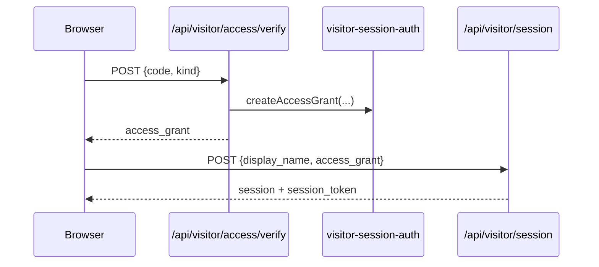

# Visitor Onboarding (Team vs Demo)

This guide documents Denizen's onboarding and access control flow for browser visitors, including team-code and email-based access, session token enforcement, and org-scoped authorization.

Related docs:
- [Intelligence spine](INTELLIGENCE_SPINE.md)
- [Database schema](DATABASE_SCHEMA.md)
- [Architecture](ARCHITECTURE.md)

---

## Entry paths in the welcome modal

`src/visitor-session.js` renders a welcome modal with three primary entry modes:

| Path | UX copy | Result |
|---|---|---|
| Demo | "Try demo" | Creates a demo-tier session in demo org (`acme`) |
| Team code | "Team access" | Verifies team code (`1921` default), issues `access_grant`, creates team session in `zion` |
| Team email | "Team email login" | Register/login flow using work email and team code; issues `access_grant` |

Optional:
- CEO path appears when `DENIZEN_CEO_ACCESS_CODE` is configured.

---

## Codes and grants

### Team code and CEO code

`src/prompt-tuning.js` defines defaults:
- `DENIZEN_TEAM_CODE` -> default `1921`
- `DENIZEN_CEO_ACCESS_CODE` -> empty by default (disabled unless set)

Verification endpoint:
- `POST /api/visitor/access/verify`

Behavior (`src/visitor-access.js`):
- Valid team code -> `ok: true`, tier `team`, org slug, signed `access_grant`
- Valid CEO code -> `ok: true`, signed `ceo_grant`
- Invalid code -> access denied

### Access grant lifecycle



---

## Session tokens and enforcement

`000011_team_accounts_and_session_auth.sql` adds `denizen_visitor_sessions.session_token_hash`.

Token behavior:
1. Session creation returns a bearer-style `session_token` to the browser.
2. Server stores only `session_token_hash`.
3. Browser sends `X-Session-Token` on protected actions.
4. `assertSessionToken(sessionId, token)` validates token against hash.

This blocks session spoofing (session ID alone is not sufficient for privileged operations).

---

## Team email register/login

`src/denizen-team-auth.js` supports:

| Endpoint family | Action | Notes |
|---|---|---|
| `/api/visitor/auth/register` | Create team account | Requires `email`, `display_name`, and valid team code |
| `/api/visitor/auth/login` | Login (or bootstrap with valid code) | Existing account login; optional auto-create path with code |

Storage table: `denizen_team_accounts`
- Unique per `(org_id, email)`
- Optional link to current `visitor_session_id`
- Tracks `last_login_at`

After auth, server returns signed `access_grant` and team-org context.

---

## Access grants, org membership, and capability gating

### Session metadata and org assignment

When a session is created/updated (`src/denizen-visitor.js`):
- Access grant metadata populates tier/org/access method.
- Session gets `org_id`.
- `ensureOrgMembership(...)` inserts/maintains `denizen_org_members` bridge row.

### Browser capability gating

`src/visitor-capabilities.js` gates front-end features:
- Demo: no operator panels, CEO handoff, or real tools.
- Team/CEO: operator panels, handoff, real tools, briefing panel enabled.

### Server-side feature enforcement

`src/visitor-access.js` enforces tier restrictions:
- Demo-restricted features include `to_ceo`, `bridge_skill`, `briefing`, and others.
- `canUseRealWork(...)` denies real-tool actions for demo org/tier even if globally enabled.

---

## Org-scoped DB authorization helpers

Migration `000012_platform_identity_bridge.sql` introduces:

| Function | Purpose |
|---|---|
| `denizen_auth_user_org_ids()` | Enumerates orgs reachable by auth identity (team account email, owned clients, admin roles) |
| `denizen_user_can_access_org(p_org_id)` | Shared RLS predicate used in platform and denizen policies |

These helpers power org-scoped read access across onboarding-adjacent and business tables.

---

## Demo vs team behavior matrix

| Capability | Demo (`acme`) | Team (`zion`) |
|---|---|---|
| Create visitor session | Yes | Yes |
| Claim assistant NPC | Yes (non-protected) | Yes |
| Team handoff to CEO | No | Yes |
| Briefings/proactive team workflows | Restricted | Enabled |
| Real tool execution | Denied | Allowed (subject to org settings) |
| Business table visibility | Restricted by org policy | Allowed by org policy + RLS |

---

## Smoke testing onboarding

Use `scripts/smoke-onboarding.js` for fast end-to-end checks:

```bash
node scripts/smoke-onboarding.js
```

What it verifies:
- Team code verification (`1921`) returns access grant.
- Demo session lands in `acme`.
- Metadata spoofing into team tier is blocked.
- Claim endpoint requires valid session token.
- Demo -> CEO handoff path is blocked.
- `denizen_user_can_access_org` policy behavior is wired.
- Invalid CEO code is rejected.

---

## Troubleshooting

- `403 DENIED` on team session creation: invalid/expired access grant or token mismatch.
- `403 DEMO_RESTRICTED`: caller is demo tier or demo org settings are active.
- Missing team-auth behavior: ensure migration `000011` exists and API routes are mounted.
- Cross-org visibility issues: verify `denizen_user_can_access_org` and table policies from `000012/000013`.
