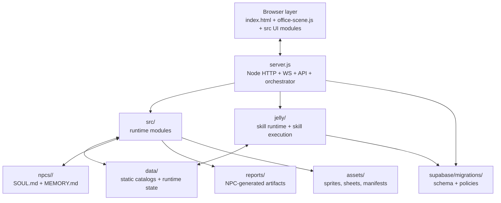

# Denizen Workspace Architecture (Canonical)

This document is the canonical map of the Denizen workspace: what each major folder/file is, why it exists, and what depends on it.  
Scope is intentionally **non-sensitive** and focused on code/runtime architecture.

## 1) Overview Diagram

## 2) Layer Table (Canon vs Runtime vs Ephemeral)

| Layer | Definition | Typical locations | Git policy |
|---|---|---|---|
| Canon (git) | Source of truth for behavior and reproducible setup | `server.js`, `src/`, `jelly/`, `docs/`, `tests/`, `tools/`, `supabase/migrations/`, static catalogs in `data/` | Commit |
| Runtime (local) | Machine-specific or session-mutated state persisted to disk | `data/llm-telemetry.jsonl`, `data/*-proposals.json`, `data/email-*.json`, `data/assistant-profile.json`, `npcs/*/MEMORY.md` | Do not commit |
| Ephemeral (memory/process) | Live in-process state, queues, sockets, temporary worktrees | World state in memory, WS sessions, in-memory queues, `.npc-worktrees/`, transient report generation flow | Never commit |

## 3) Folder-by-folder

### `src/` (runtime modules grouped by domain)

#### A) Core orchestration + world runtime

| File | Purpose | Loads/called by |
|---|---|---|
| `src/load-env.js` | Early env bootstrap and defaulting | `server.js` |
| `src/logger.js` | Structured runtime logger | Widely used by server-side modules |
| `src/world-state.js` | In-memory shared state (NPCs, tasks, presence, threats) | `server.js`, office runtime modules |
| `src/agent-bus.js` | Internal message bus between runtime components | `server.js`, AI/system modules |
| `src/agent-office-manager.js` | Client-side orchestration of NPC actions from decisions/events | `office-scene.js` |
| `src/agent-actions.js` | Primitive NPC actions (move, talk, meet, report, work) | `agent-office-manager.js` |
| `src/npc-agent-controller.js` | Think-loop driver and NPC control integration | `office-scene.js` |
| `src/pathfinding.js` | A* grid movement pathing | NPC movement/action modules |
| `src/openclaw-worldstate-bridge.js` | Bridge between external agent events and world state | runtime integration paths |
| `src/openclaw-chat.js` | Embedded OpenClaw chat panel integration | browser UI, `office-scene.js` |
| `src/chat-bootstrap.js` | Chat UI initialization/bootstrap glue | browser startup path |
| `src/denizen-phone-ui.js` | Buzz phone HUD — the toolbar; opens tools via their module APIs | browser UI |
| `src/diag.js` | Diagnostics UI toggle/panel hooks | browser scene/UI |
| `src/denizen-lazy-scripts.js` | Lazy script loader for optional modules | `office-scene.js` |
| `src/mobile-controls.js` | Touch/mobile movement controls | browser scene |
| `src/mobile-haptics.js` | Vibration/haptic behavior for mobile | mobile control flow |
| `src/touch-bind.js` | Touch input binding helper | mobile/touch setup |
| `src/room-tile-renderer.js` | Tile rendering helper for room/city paths | room/world rendering modules |

#### B) NPC brains + social behavior

| File | Purpose | Loads/called by |
|---|---|---|
| `src/npc-brains.js` | Core `NpcBrainManager`; think/respond loops and memory integration | `server.js` |
| `src/npc-roster.js` | Canonical NPC roster and folder/sprite mapping | `server.js`, scene startup |
| `src/npc-tools.js` | Safe tool helpers for NPC workflows | `server.js`, skill/runtime calls |
| `src/npc-capabilities.js` | Capability registry and checks | `server.js`, proposal/runtime flows |
| `src/soul-reflection.js` | SOUL proposal generation/apply flow | `server.js`, proposal endpoints |
| `src/capability-proposal.js` | Capability proposal queue validation/management | `server.js` |
| `src/animation-forge.js` | Animation proposal/validation pathway | `server.js`, proposal APIs |
| `src/ambient-dialogue.js` | Ambient chatter scheduling and injection | `server.js`, office loop |
| `src/sentiment.js` | Lightweight sentiment/mood tagging | NPC conversation/runtime paths |
| `src/escalation-engine.js` | Escalation logic for elevated tasks/events | orchestration modules |
| `src/meeting-runner.js` | Coordinated meeting execution path | `server.js`, NPC action orchestration |
| `src/conflict-detector.js` | Artifact conflict detection for arbitration | `server.js`, artifact pipeline |
| `src/work-feed.js` | HUD feed for ongoing NPC outputs | `office-scene.js`, event handlers |
| `src/player-chat.js` | Player-to-NPC chat handling | browser chat flow + server responses |
| `src/assistant-mode.js` | Assistant interaction mode controls | browser/system UI |

#### C) Visitor + access + onboarding domain

| File | Purpose | Loads/called by |
|---|---|---|
| `src/denizen-visitor.js` | Visitor lifecycle APIs and orchestration | `server.js` routes |
| `src/visitor-access.js` | Access-code and entitlement checks | `server.js`, visitor APIs |
| `src/visitor-session.js` | Session lifecycle/state | visitor/auth routes |
| `src/visitor-session-auth.js` | Session token auth guardrails | `server.js` auth middleware |
| `src/denizen-team-auth.js` | Team account/session auth support | `server.js` |
| `src/visitor-onboarding.js` | Onboarding flow state/logic | visitor UI + onboarding endpoints |
| `src/visitor-assistant-labels.js` | Labeling helpers for assistant assignment | visitor UX flows |
| `src/visitor-capabilities.js` | Visitor capability matrix and checks | visitor APIs and UI |
| `src/visitor-claim-ui.js` | UI path for claiming assistant/session | browser visitor UI |
| `src/visitor-projects-ui.js` | Visitor project view UI | browser visitor UI |
| `src/visitor-handoff-ui.js` | Handoff status/transfer UI | visitor workflow UI |
| `src/visitor-briefing-ui.js` | Visitor briefing display UI | browser + briefing endpoints |
| `src/visitor-voice-walkup.js` | Walk-up voice interaction glue for visitor mode | voice + visitor flow |

#### D) Intelligence spine + telemetry domain

| File | Purpose | Loads/called by |
|---|---|---|
| `src/denizen-db.js` | DB gateway for intelligence, outcomes, and facts | `server.js`, intelligence modules |
| `src/denizen-org-policy.js` | Org-level policy checks for data/actions | `server.js`, data actions |
| `src/denizen-visitor-intelligence.js` | Visitor-facing intelligence summaries/briefings | `server.js`, visitor routes |
| `src/visitor-briefing-loop.js` | Background briefing/intel loop starter | `server.js` startup |
| `src/mirofish-prediction.js` | Prediction helpers and forecasts | `server.js`, intelligence routes |
| `src/denizen-prediction-loop.js` | Prediction maintenance loop + summary APIs | `server.js` |
| `src/federal-pipeline.js` | Federal/RFP pipeline summarization logic | `server.js`, route registry |
| `src/llm-telemetry.js` | LLM call telemetry collection/persistence | `server.js`, AI call sites |
| `src/llm-telemetry-panel.js` | UI panel for telemetry insights | browser diagnostics |
| `src/telemetry-insights.js` | Aggregation/insight endpoints for telemetry | `server.js` API endpoints |
| `src/external-sink.js` | Forward telemetry/events to external sink endpoints | `server.js`, telemetry flow |
| `src/hallucination-guard.js` | Runtime guardrail metrics/checks | `server.js` status endpoints |
| `src/prompt-tuning.js` | Prompt tuning helpers/config normalization | `server.js`, brain orchestration |
| `src/away-notify.js` | Presence/away signaling in intelligence loops | `server.js`, scheduler flows |

#### E) Security + monitoring domain

| File | Purpose | Loads/called by |
|---|---|---|
| `src/security-feed.js` | Security feed UI/event surface | browser security dashboard |
| `src/security-monitor.js` | Client security WS/event handling | `office-scene.js` |
| `src/security-ip.js` | IP classification helpers (local/internal threat checks) | `server.js` security paths |
| `src/robber-controller.js` | Visual threat actor controller in scene | `office-scene.js`, security events |
| `src/linux-agent.js` | WSL/Kali security command runner | `server.js` security endpoints |
| `src/pc-activity-tracker.js` | Local PC activity tracking signals | `server.js` security/context |
| `src/permission-registry.js` | Permission policy and operation guardrails | runtime-protected endpoints |
| `src/screen-watch.js` | Screen watch hooks for monitoring | observation/desktop workflows |
| `src/screen-observe.js` | Screen observation and capture path | `server.js`, desktop/agent flows |
| `src/browser-mirror-panel.js` | Browser mirror UI panel for observation | browser UI tools |

#### F) Voice + audio domain

| File | Purpose | Loads/called by |
|---|---|---|
| `src/voice-gate.js` | Presence-gated speaking policy | browser voice runtime |
| `src/voice-input.js` | Speech input capture flow | browser voice UX |
| `src/voice-resolve.js` | Voice selection/resolution per NPC/context | `server.js`, TTS path |
| `src/elevenlabs-provider.js` | Browser-side TTS provider wrapper | voice playback flow |
| `src/elevenlabs-tts.js` | Server-side ElevenLabs API proxy | `server.js` `/api/tts*` |
| `src/proximity-audio.js` | Distance-based volume attenuation | scene audio runtime |
| `src/sfx.js` | SFX playback manager | browser scene events |

#### G) Research + discovery domain

| File | Purpose | Loads/called by |
|---|---|---|
| `src/research-queue.js` | Queue for pending research jobs | `server.js`, research routes |
| `src/research-sessions.js` | Sessionized research tracking | `server.js`, research APIs |
| `src/research-brief.js` | Brief generation from research artifacts | `server.js`, briefing paths |
| `src/research-scheduler.js` | Scheduler for research loops/jobs | `server.js` startup (`startAll`) |
| `src/web-research.js` | Web research helper abstraction | `server.js`, skills/routes |
| `src/visitor-cited-research.js` | Citation-backed research for visitor surfaces | `server.js` visitor routes |
| `src/lucy-search-brief.js` | Search-result brief synthesis for Lucy workflows | `server.js`, Lucy routes |

#### H) Job/email pipeline domain

| File | Purpose | Loads/called by |
|---|---|---|
| `src/email-handler.js` | Inbound email intake, compose, escalation gating | `server.js` email endpoints |
| `src/gmail-client.js` | Gmail send/draft integration adapter | `email-handler.js`, routes |
| `src/job-application.js` | Lucy job pipeline orchestration | `server.js` job APIs |
| `src/job-crm.js` | Job CRM maintenance/summary logic | `server.js`, route registry |
| `src/denizen-slack-channel.js` | Slack notification/channel bridge | `server.js`, event paths |

#### I) Skill/MCP + coding pipeline domain

| File | Purpose | Loads/called by |
|---|---|---|
| `src/openclaw-dispatch.js` | Dispatch helpers for skill/action-style calls | `server.js` |
| `src/denizen-mcp-connector.js` | Generic MCP client wrapper and tool calls | `server.js`, integration routes |
| `src/npc-browser-paths.js` | Browser profile/path resolution per NPC | `server.js`, browser skill paths |
| `src/skill-builder.js` | Build/new-skill orchestration module | `server.js`, skill workflows |
| `src/coding-task-runner.js` | Isolated coding worktree proposal runner | `server.js` proposal APIs |
| `src/task-chain.js` | Multi-step NPC chain orchestration | `server.js`, chain APIs |
| `src/desktop-agent.js` | Desktop automation agent integration | `server.js`, agent APIs |
| `src/computer-use-agent.js` | Computer-use integration surface | runtime agent flows |
| `src/file-agent.js` | File-operation agent orchestration | server-side agent/tooling paths |
| `src/openclaw-translator.js` | Event/message translation between systems | integration pathways |
| `src/gateway-bridge.js` | Gateway bridging compatibility module | browser/server integration |
| `src/nas-connect.js` | NAS connectivity helper | runtime utility paths |

#### J) City/world generation domain

| File | Purpose | Loads/called by |
|---|---|---|
| `src/RoomAssembly.js` | Room assembly from catalog/template definitions | dynamic import in `office-scene.js` |
| `src/RoomBuilder.js` | Room construction helper | room assembly/runtime |
| `src/RoomGenerator.js` | Procedural single-room generator | dynamic import in `office-scene.js` |
| `src/city/cityGenerator.js` | Top-level city generation algorithm | `city-debug.js`, tests, routes |
| `src/city/planner.js` | City planner logic and zoning heuristics | city generation paths |
| `src/city/planner-heuristic.cjs` | Heuristic planner used by API route path | loaded by `server.js` route |
| `src/city/interiorGenerator.js` | Interior generation for city buildings | dynamic import in `office-scene.js` |
| `src/city/phaserAdapter.js` | Adapts generated city output to Phaser objects | dynamic import in `office-scene.js` |
| `src/city/RoomAssembly.js` | City-specific room assembly variant | city render/build path |
| `src/city/RoomAssemblyIntegration.js` | Integration glue between city output and room assembly | city runtime paths |
| `src/city/RoomBuilder.js` | City room builder support module | city layout assembly |
| `src/city/cityTypes.js` | Shared city type/constants definitions | city modules |
| `src/world/generator.js` | World generation runtime | dynamic import in `office-scene.js` |
| `src/world/renderer.js` | World renderer runtime | dynamic import in `office-scene.js` |
| `src/world/debug.js` | World debug overlays/hooks | dynamic import in `office-scene.js` |
| `src/world/rng.js` | Seeded RNG for deterministic world generation | world/city modules |
| `src/world/recipes.js` | World recipe definitions for layouts | world generator |
| `src/world/roomFurnisher.js` | Furnisher logic | world generation |
| `src/world/roomFurnisherRuntime.js` | Runtime furnisher execution variant | world runtime |
| `src/world/animRegistry.js` | Animation registry for world entities | world/scene runtime |

#### K) Routing/API composition files

| File | Purpose | Loads/called by |
|---|---|---|
| `src/route-registry.js` | Central route registration for integration APIs | `server.js` |
| `src/routes/intelligence-routes.js` | Intelligence route handlers | `route-registry.js`, `server.js` |
| `src/office-director.js` | Office director coordination logic | server orchestration and tests |
| `src/cost-projector.js` | Cost projection and budget calculation path | `server.js`, APIs |
| `src/market-data.js` | Market data retrieval/formatting | route registry and trading modules |
| `src/robinhood-mcp.js` | Robinhood MCP/trading integration module | `server.js`, trading routes |
| `src/demo-scene.js` | Demo/tour scene overlays/automation | lazy-loaded by `office-scene.js` |
| `src/city-debug.js` | City debug visualization control | optional debug path |
| `src/world-state.js` | Shared state object (listed once above; central to routes too) | APIs, WS broadcasts, brains |

---

### `jelly/` (skill runtime and execution system)

#### Core executor/runtime

| File | Purpose | Loads/called by |
|---|---|---|
| `jelly/index.js` | `createJelly()` runtime entry and orchestration | `server.js` skill dispatch paths |
| `jelly/skill-executor.js` | Executes skills (native + legacy subprocess mode) | `jelly/index.js` |
| `jelly/skill-registry.js` | Discovers/registers skill handlers and aliases | `jelly/index.js` |
| `jelly/config-loader.js` | Loads Jelly config with fallback behavior | `jelly/index.js` |
| `jelly/config-provider.js` | Shared config accessors | runtime + skill modules |
| `jelly/paths.js` | Runtime paths and Jelly dir guarantees | `jelly/index.js`, services |
| `jelly/meta.js` | Version/metadata constants | `jelly/index.js` |

#### Native skills (`jelly/skills/*`)

| File | Purpose | Loads/called by |
|---|---|---|
| `jelly/skills/browserclaw/index.js` | BrowserClaw skill adapter | Jelly executor |
| `jelly/skills/supabase/index.js` | Supabase bridge skill adapter | Jelly executor |
| `jelly/skills/research/index.js` | Research skill surface | Jelly executor |
| `jelly/skills/job-pipeline/index.js` | Job pipeline orchestration skill | Jelly executor |
| `jelly/skills/security-linux/index.js` | Linux/security helper skill | Jelly executor |
| `jelly/skills/trade-suggest/index.js` | Trade suggestion skill | Jelly executor |
| `jelly/skills/market-watch/index.js` | Market watch monitoring skill | Jelly executor |
| `jelly/skills/github/index.js` | GitHub action skill | Jelly executor |
| `jelly/skills/coding-agent/index.js` | Coding-agent skill wrapper | Jelly executor, coding flow |
| `jelly/skills/build-skill/index.js` | Skill generation/build helper skill | Jelly executor |
| `jelly/skills/denizen-data/index.js` | Denizen data actions skill surface | Jelly executor |

#### Shared libraries

| File | Purpose | Loads/called by |
|---|---|---|
| `jelly/lib/bridge-client.js` | Secure bridge HTTP client (`query`/`insert`/`update`/`health`) | data skills, supabase skill |
| `jelly/lib/denizen-data-actions.js` | Business/intelligence action catalog + org guardrails | `denizen-data` skill, runtime |

#### Vendor skills (`jelly/vendor/skills/*`) for compatibility/legacy execution

| File/folder | Purpose | Loads/called by |
|---|---|---|
| `jelly/vendor/skills/browserclaw/*` | Vendor BrowserClaw implementations | legacy subprocess skill path |
| `jelly/vendor/skills/supabase-bridge/*` | Vendor Supabase bridge script | legacy subprocess path |
| `jelly/vendor/skills/job-scraper/*` | Job scraping implementation | job pipeline chain |
| `jelly/vendor/skills/job-applier/*` | Job apply automation implementation | job pipeline chain |
| `jelly/vendor/skills/job-apply-shared/*` | Shared anti-detect/session/captcha/browser helpers | job-scraper/job-applier |
| `jelly/vendor/skills/resume-generator/*` | Resume generation + HTML templates | job pipeline chain |
| `jelly/vendor/skills/pdf-generator/*` | PDF generation helper | report/resume/doc outputs |
| `jelly/vendor/skills/web-search/*` | Web search helper skill | research/utility flows |
| `jelly/vendor/skills/canvas-render/*` | Render HTML/canvas snapshots | artifact generation |
| `jelly/vendor/skills/screen-capture/*` | Screen capture helper | observation/report flows |
| `jelly/vendor/skills/lm-studio/*` | LM Studio utility scripts (status/ops) | local model operations |

#### Services

| Path | Purpose | Loads/called by |
|---|---|---|
| `jelly/services/browserclaw/server.mjs` | BrowserClaw service process entry | `scripts/start-jelly-services.ps1` |
| `jelly/services/browserclaw/browserclaw.mjs` | BrowserClaw runtime main | BrowserClaw service |
| `jelly/services/browserclaw/lib/browser-agent.mjs` | Browser agent logic | BrowserClaw service runtime |
| `jelly/services/browserclaw/package.json` | Service package/runtime metadata | npm tooling for service |
| `jelly/services/supabase-bridge/secure-bridge.py` | Secure Supabase bridge service | `scripts/start-jelly-services.ps1`, Jelly bridge-client |
| `jelly/services/supabase-bridge/SECURE-BRIDGE-README.md` | Bridge operation notes | operators/developers |
| `jelly/services/supabase-bridge/rfp-schema-secure.sql` | Secure schema/SQL helper asset | bridge and DB operations |
| `jelly/services/supabase-bridge/.env.secure.template` | Safe template for bridge env vars | local setup |
| `jelly/services/supabase-bridge/.env.secure` | Local secure env file | local runtime only (never commit secrets) |

---

### `data/` split: static catalogs (COMMIT) vs runtime JSON (DO NOT COMMIT)

#### A) Static catalogs and definitions (commit)

| File | Purpose |
|---|---|
| `data/assets-index.json` | Asset index consumed by runtime/tools |
| `data/limezu-manifest.json` | LimeZu asset manifest and references |
| `data/limezu-labels.json` | Label vocabulary for LimeZu assets |
| `data/master_furniture_catalog.json` | Canon merged furniture catalog |
| `data/furniture_catalog.json` | Base furniture catalog |
| `data/furniture_catalog_openplan.json` | Open-plan layout catalog |
| `data/furniture_catalog_limezu.json` | LimeZu-specific catalog subset |
| `data/furniture_catalog_promo.json` | Promo/marketing subset catalog |
| `data/catalog_modern_office_16.auto.json` | Auto-generated office catalog (16) |
| `data/catalog_modern_office_32.auto.json` | Auto-generated office catalog (32) |
| `data/catalog_modern_office_48.auto.json` | Auto-generated office catalog (48) |
| `data/room-builder-tiles.json` | Room tile definitions |
| `data/room-templates.json` | Room templates used by assembly/generation |
| `data/object-defs.json` | Object/type definitions |
| `data/definitions.json` | Runtime object definitions |
| `data/sheet_registry.json` | Sprite sheet registry |
| `data/sprite-map-modern-office.json` | Sprite map for office pack |
| `data/sprite-assembly-system.json` | Assembly system definitions |
| `data/interiors.json` | Interior config data |
| `data/exteriors.json` | Exterior config data |
| `data/map-layout.json` | Layout map blueprint |
| `data/layout_openplan_manifest.json` | Open-plan layout manifest |
| `data/full-world-blueprint.json` | Blueprint for world generation |
| `data/reference_sheets_modern_office.json` | Reference sheet metadata |
| `data/reference_office_scene_crops.json` | Crop references for office scenes |
| `data/reference_office_matches.json` | Match/reference mappings |
| `data/scene_recipes_modern_office_openplan_bullpen.json` | Scene recipe |
| `data/scene_recipes_modern_office_reception.json` | Scene recipe |
| `data/scene_recipes_modern_office_small_office.json` | Scene recipe |
| `data/scene_recipes_reference_office_small.json` | Reference scene recipe |
| `data/modern_ui_catalog.json` | UI asset catalog |
| `assets/sfx-map.json` | SFX mapping definitions |
| `data/animations_character_animations.json` | Character animation defs |
| `data/animations_portrait_animations.json` | Portrait animation defs |
| `data/world/prefabs/README.md` | Prefab folder contract |
| `data/SPRITES_OVERVIEW.md` | Sprite documentation |
| `data/CUBICLE_POD_BLUEPRINT.md` | Layout blueprint documentation |
| `data/company-brief.json` | Company/team context injected into prompts |
| `data/mcp-servers.json` | MCP server registry config |
| `data/openclaw-agent-map.json` | Agent mapping config for integration |

#### B) Runtime, mutable, or sensitive local state (do not commit)

| File | Why it should remain local |
|---|---|
| `data/llm-telemetry.jsonl` | High-churn runtime log stream |
| `data/assistant-profile.json` | Runtime-mutated assistant profile |
| `data/email-drafts.json` | Drafts can contain private conversation data |
| `data/email-log.json` | PII-bearing email activity history |
| `data/job-application-log.json` | Personal/job application activity log |
| `data/research-queue.json` | Runtime queue state |
| `data/research-scheduler-state.json` | Runtime scheduler cursor/state |
| `data/research-sessions.json` | Session-local research history |
| `data/tasks.json` | Runtime task board state |
| `data/capability-proposals.json` | Runtime proposal queue |
| `data/animation-proposals.json` | Runtime proposal queue |
| `data/soul-proposals.json` | Runtime proposal queue |
| `data/trade-suggestions.json` | Potentially sensitive strategy output |
| `data/robinhood-oauth.json` | OAuth credentials/tokens |
| `data/gmail-oauth.json` | OAuth credentials/tokens |
| `data/permissions.json` | Host path and permission mappings |
| `data/user-profile.json` | Personal profile and PII fields |
| `data/voice-map.json` | Voice IDs and personal runtime mappings |
| `data/bouncer-baseline.json` | Runtime baseline used by security patrol |
| `data/job-crm.json` | Mutable CRM runtime state |
| `data/job-outcomes.json` | Runtime outcomes/metrics log |

> Practical policy: treat anything in `data/` that is machine-identity, credential-bearing, or frequently mutated as local runtime state unless explicitly intended as a canonical catalog.

---

### `assets/limezu/` (sprite pack structure)

| Path | Purpose |
|---|---|
| `assets/limezu/index.json` | Root manifest/index for LimeZu pack ingestion |
| `assets/limezu/characters/` | Character sheets used for NPC/player sprites |
| `assets/limezu/animated/` | Animated object sheets (doors, tvs, escalators, etc.) |
| `assets/limezu/exteriors/` | Exterior terrain/building/prop sheets |
| `assets/limezu/exteriors/office_singles/` | Single-sprite office exterior cuts |
| `assets/limezu/examples/` | Example layer compositions and previews |

Why this exists:
- Keeps third-party art pack data organized and separable from runtime code.
- Enables scripted catalog extraction and deterministic references in `data/*catalog*.json`.
- Preserves source-quality sheets while scripts generate runtime-friendly manifests/crops.

---

### `npcs/` (`SOUL.md` vs `MEMORY.md`)

| File type | Role in system | Git guidance |
|---|---|---|
| `npcs/<npc>/SOUL.md` | Canonical NPC identity/personality/provider/role instructions | Commit |
| `npcs/<npc>/MEMORY.md` | Runtime memory append log for that NPC | Do not commit |

Why split them:
- `SOUL.md` is the durable "contract" of who the NPC is.
- `MEMORY.md` is high-churn episodic state; committing it causes noisy drift and can leak transient/sensitive context.

---

### `reports/` (NPC artifact pipeline)

Artifact flow:
1. NPC reaches `taskPhase: finished` or equivalent completion signal.
2. Runtime creates markdown artifact in a category folder.
3. Artifact is used for review/audit, and may feed chain/conflict/briefing logic.

Observed category folders:

| Category folder | Typical producer |
|---|---|
| `reports/security/` | Bouncer/security workflows |
| `reports/code-reviews/` | Engineering/review NPCs |
| `reports/bugs/` | QA findings |
| `reports/pm-reports/` | PM/product status updates |
| `reports/data-reports/` | Data/intelligence updates |
| `reports/design/` | Design outputs |
| `reports/it-reports/` | IT operations reports |
| `reports/devops/` | DevOps/infrastructure updates |
| `reports/intern-notes/` | Intern/team assistant notes |
| `reports/admin/` | Admin/reception outputs |
| `reports/research/` | Research artifacts |
| `reports/leadership/` | Leadership directives/summaries |

Gitignore reality:
- Report artifacts are **runtime-generated outputs** and should generally be treated as local operational artifacts.
- Current ignore coverage explicitly includes `reports/run-*.json` and other runtime files; keep high-volume generated report streams out of source-control workflows unless you intentionally curate them as audit artifacts.

---

### `scripts/` (asset pipeline vs ops scripts)

#### Asset pipeline (content build)

| Script | Purpose |
|---|---|
| `scripts/run-pipeline.js` | Orchestrates asset pipeline steps |
| `scripts/extract_all_sheets.ps1` | Batch slice sheets into per-sprite assets |
| `scripts/extract_sheet_objects.py` | Extract objects from sheets |
| `scripts/slice_sheet_scanner.py` | Grid-oriented extraction/scanning |
| `scripts/build_master_catalog.py` | Build canonical master catalog |
| `scripts/label_sprites_ai.py` | AI label pass for sprites |
| `scripts/autolabel_from_path.py` | Heuristic label pass |
| `scripts/patch_catalog_labels.py` | Label corrections |
| `scripts/build_ui_catalog.py` | Build UI-focused catalog subsets |
| `scripts/make_sprite_mosaics.py` | Mosaic/visual QA outputs |
| `scripts/build_singles_manifest.js` | Build singles manifest for browser tools |

#### Ops/deploy/integration scripts

| Script | Purpose |
|---|---|
| `scripts/start-jelly-services.ps1` | Start Jelly sidecars (Supabase bridge + BrowserClaw) |
| `scripts/apply-all-migrations.ps1` | Apply migration batches |
| `scripts/apply-migration-admin.ps1` | Apply admin-role migration |
| `scripts/deploy-production.ps1` | Deployment orchestration |
| `scripts/verify-production-schema.js` | Schema readiness checks |
| `scripts/smoke-onboarding.js` | Onboarding smoke tests |
| `scripts/smoke-spine-e2e.js` | Intelligence spine smoke tests |
| `scripts/robinhood-live-smoke.js` | Live trading integration smoke path |
| `scripts/tts-smoke.js` | Voice/TTS smoke checks |
| `scripts/sync-voice-map.js` | Voice map synchronization helper |

---

### `tests/`, `tools/`, `config/`

| Path | What it is | Why it exists |
|---|---|---|
| `tests/` | Node test suites (unit, integration, e2e) | Guard behavior across brains, visitor flows, routes, generation, and integrations |
| `tests/e2e/visitor-assistant.e2e.js` | Visitor assistant E2E path | End-to-end confidence for main visitor workflow |
| `tools/limezu-sprite-browser.html` | LimeZu sprite inspection utility | Asset QA and discovery |
| `tools/limezu-single-preview.html` | Single sprite preview utility | Validate crops/manifests |
| `tools/room-preview.html` | Room composition preview utility | Validate room templates/layouts |
| `tools/tile-inspector.html` | Tile inspection utility | Tile metadata and render checks |
| `config/jelly.json` | Jelly runtime configuration | Centralized skill runtime/service config |

---

### `supabase/migrations/`

| Migration family | Purpose |
|---|---|
| `20260606000000` to `00003` | Foundation + core work/events and CEO/pipeline base |
| `20260606000004` to `00006` | Intelligence layer + triggers/outcome mechanics |
| `20260606000007` to `00011` | Entity/policy updates, demo org, team/session auth |
| `20260606000012` to `00014` | Platform identity bridge, admin tables, trading spine |

Operational role:
- Defines durable DB contracts for visitor/intelligence/trading surfaces.
- Keeps runtime/server assumptions synchronized with schema via ordered SQL evolution.

## 4) Sensitive Files and "Never Commit" Rules

Never commit:

| Pattern/file | Why |
|---|---|
| `.env`, `.env.*` | Secrets and environment credentials |
| `openclaw.json` (local creds) | Provider API keys/token material |
| `data/gmail-oauth.json`, `data/robinhood-oauth.json` | OAuth secrets/tokens |
| `data/user-profile.json` | Personal identity + PII |
| `data/permissions.json` | Local host path disclosure + privilege mapping |
| `jelly/services/supabase-bridge/.env.secure` | Bridge secrets |
| `*.pem`, `*.key` | Private keys/certs |
| `npcs/*/MEMORY.md` | Runtime memory that can include private content |
| proposal/log outputs (`data/*-proposals.json`, `data/llm-telemetry.jsonl`) | High-churn and potentially sensitive runtime traces |

Rule of thumb:
- If the file contains credentials, machine-specific paths, personal profile data, OAuth state, or rapidly mutating runtime logs, keep it local.

## 5) Cross-links

- `docs/DOCS_INDEX.md` — global docs map and status tags.
- `docs/DATABASE_SCHEMA.md` — table-by-table data contract reference.
- `docs/ARCHITECTURE.md` — runtime topology and decision loops.
- `docs/JELLY_INTEGRATION.md` — Jelly runtime and skill dispatch contract.

